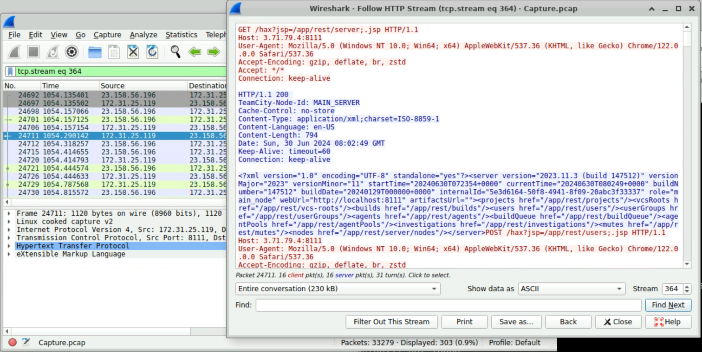
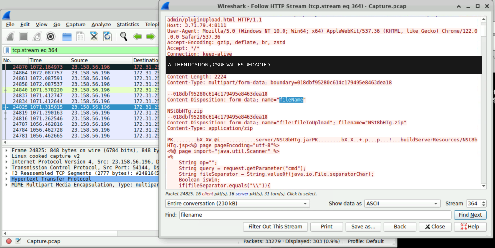
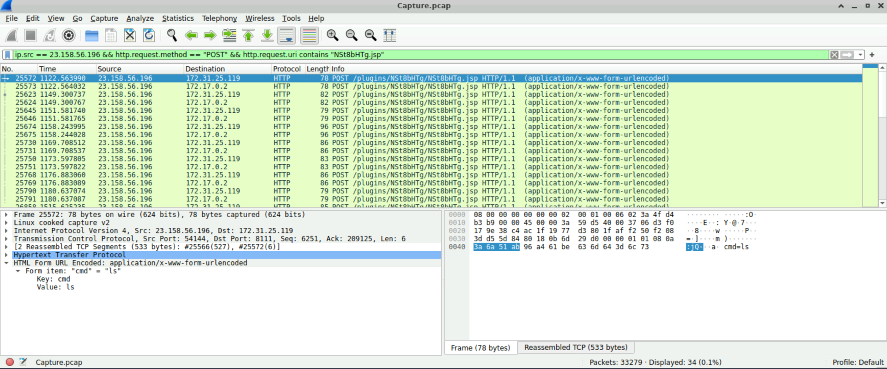
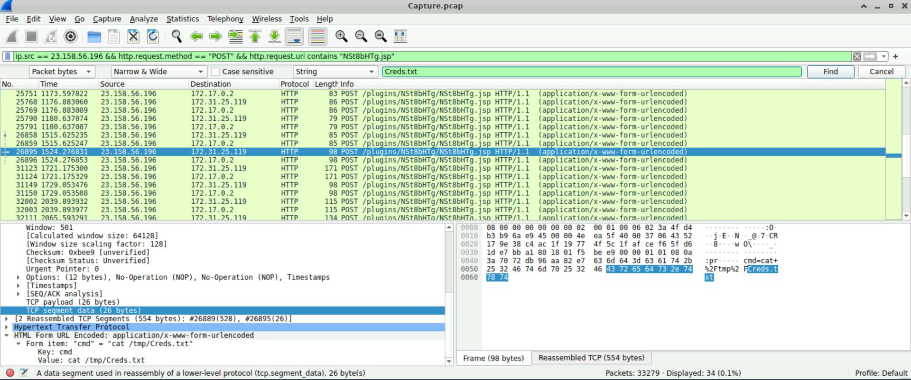
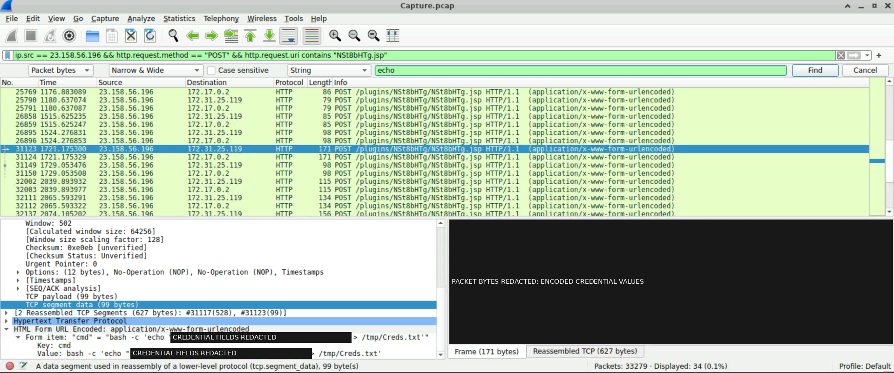
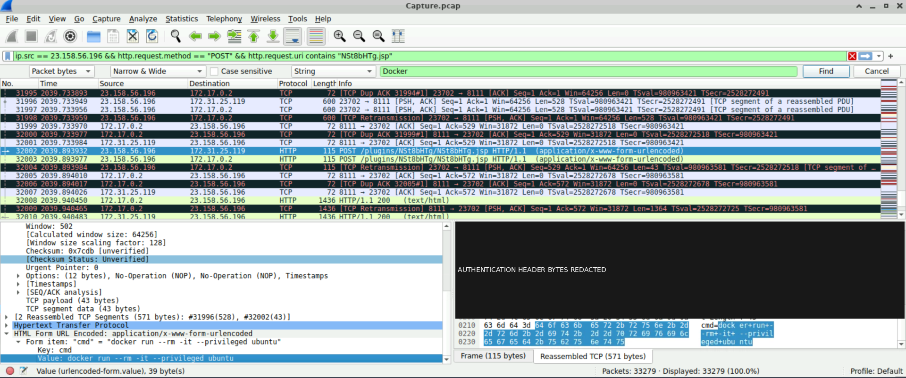
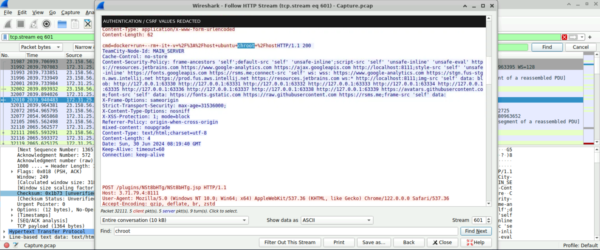

# CyberDefenders JetBrains TeamCity Investigation Report

## 1. Title and investigation metadata

| Field | Assessment |
|---|---|
| Investigation | CyberDefenders JetBrains TeamCity lab |
| Report date | 2026-11-07 |
| Report purpose | Integrated incident-response report for a SOC Analyst portfolio |
| Evidence basis | 70 preserved screenshots; seven selected packet events; seven existing report figures |
| Identified service | Advertised JetBrains TeamCity 2023.11.3, build 147512 |
| Incident date and duration | Not established; screenshot labels and server headers do not establish absolute event times |
| Confirmed incident severity | **Undetermined** |
| Recommended response priority | **High:** F-002/F-006/F-007; **Medium:** F-001/F-003/F-004/F-005; all provisional |
| Quality assurance | [Final consistency QA: PASS](FINAL_CONSISTENCY_QA.md), closing the required corrections from the earlier reviews |

This report integrates the reviewed investigation records. It distinguishes displayed network observations, interpretation of requested actions, and outcomes requiring corroboration. Response priority expresses investigation urgency; it is not a confirmed incident-impact classification. All detection and response material describes proposed enterprise work, not actions performed during the lab.

## 2. Executive summary

The investigation examined network traffic associated with a JetBrains TeamCity server through preserved Wireshark screenshots. The selected sequence shows version identification, a suspicious plugin upload carrying JSP command-parameter code, and subsequent requests to a matching JSP endpoint. Submitted commands requested directory listing, reading and writing **/tmp/Creds.txt**, and Docker operations.

The Docker requests were distinct. One requested an Ubuntu container with **--privileged**, without a host-root mount or chroot. The later request specified **-v /:/host** and **chroot /host**, without the privileged flag. These requests warrant urgent validation because an operational command interface or sufficiently permissive Docker access could expose CI data and host files.

The evidence does not establish CVE-2024-27198 exploitation, plugin installation/activation, successful shell execution, credential recovery, file modification, container startup, escape or host compromise. **Incident severity remains undetermined.** High response priority reflects the serious capabilities requested, rather than confirmed successful outcomes.

The recommended next steps are to preserve and correlate TeamCity, endpoint, file and Docker records; establish authorization, daemon location and actual effects; and address patch state, plugin administration, service privileges and Docker access. The report provides eleven detection opportunities, six **proposed and untested** KQL examples, and a seven-stage response playbook.

## 3. Scope and objectives

The objectives were to identify submitted actions, connect each finding to its evidence, assess potential security implications without assuming success, and develop practical detection and response recommendations.

The evidentiary scope is the 70-screenshot preservation selection and seven selected packet events described in the [evidence register](../evidence/TECHNICAL_EVIDENCE_REGISTER.md). Seven presentation figures illustrate the findings. Multiple screenshots of a packet do not create multiple incident events, and the selected sequence is not a complete activity history.

The full source capture, TeamCity logs, deployed plugin archive, operating-system artifacts and Docker runtime records were not independently acquired or examined for this report. No enterprise telemetry or tested alerts were supplied. The requesting actor, authorization, affected assets and operational impact remain unresolved; the lab setting does not by itself establish those facts.

The practical scope includes TeamCity control servers and agents, application-to-shell activity, temporary-file access and Docker clients/daemons. Windows telemetry and account/token monitoring are conditional enterprise recommendations, not evidence that Windows infrastructure or identity creation occurred in this case.

## 4. Investigation methodology and evidence-handling limitations

### 4.1 Evidence review and interpretation

The investigation record was developed from displayed Wireshark packet and stream material. Wireshark frame numbers identify positions in the displayed capture; they are not independent proof that an application processed the request. A reassembled request combines TCP segments to expose application content. A Follow HTTP Stream view can show material from several packets, while its background selection and footer reference identify different positions.

The established workflow comprised:

1. Preserve and inventory the original screenshot selection with filenames, evidence IDs, sizes, modification timestamps and SHA-256 hashes.
2. Record readable requests, responses, decoded form values, packet references and reassembly information in the evidence register.
3. Order the selected events using frame numbers and the displayed numeric Wireshark Time values, retaining uncertainty about the time mode.
4. Assess command semantics and ATT&CK fit separately from execution, access and impact.
5. Review selected presentation figures and cross-document consistency, then apply the required report-wording and detection-logic corrections.

The register inherits prior screenshot observations. The timeline additionally documents targeted frame/Time verification for EV-008 and EV-014; the technical findings document selected-image verification; and the final consistency QA records source/derivative checks. Agreement between records that share a screenshot is not independent execution corroboration. This integration uses those validated records and performs no new PCAP investigation or original screenshot audit.

### 4.2 Preservation, redaction and provenance

The originals are preserved in the source screenshot collection; its local absolute path is omitted from this public report. [SCREENSHOT_MANIFEST.csv](../evidence/SCREENSHOT_MANIFEST.csv) inventories **EV-001 through EV-070**, from **Screenshot From 2026-11-03 00-54-22.png** through **Screenshot From 2026-11-04 21-24-13.png**, inclusive. The selection is a defined filename range within a shared screenshot directory, not every image in that directory.

SHA-256 is a file digest used to identify bytes and detect differences from a recorded baseline. The [preservation notes](../evidence/PRESERVATION_NOTES.md) document the original 70-file hashing operation. Historical QA checks recorded whole-collection integrity; final consistency QA accounted for all 70 paths/sizes/modification times and verified the seven selected original/derivative relationships. These checks do not establish prior provenance, original authenticity or a formal chain of custody.

The seven embedded figures are existing cropped presentation derivatives, with opaque redactions where necessary. They use the exact filenames in **report/figures/** and are not additional evidence. [DERIVATIVE_MANIFEST.csv](figures/DERIVATIVE_MANIFEST.csv) records source IDs/hashes, derivative hashes, crop bounds and redaction boxes. Original screenshots and figures were not altered during integration. Passwords, Bearer tokens, CSRF values and encoded representations remain omitted or masked. Original evidence should remain under restricted handling; only the selected redacted figures are embedded.

### 4.3 Time and topology limitations

Wireshark Time values are reproduced exactly. Their decimal format is consistent with relative seconds, but the selected display mode, reference point and absolute timestamp basis are unverified. Screenshot filename dates are local timezone-unspecified labels; filesystem modification times and server-supplied HTTP Date headers are separate metadata. No absolute attack time, elapsed incident duration or timezone conversion is inferred.

Source/destination addresses and HTTP Host values do not by themselves resolve public/internal service relationships, NAT, proxying, mirrored traffic or container namespaces. A Docker client may control a different daemon host. Address proximity, timing and adjacent HTTP 200 responses cannot establish request-to-process causality or successful command execution.

## 5. Environment and target identification

| Element | Evidence-supported description | Boundary of the assessment |
|---|---|---|
| Application | HTTP 200 XML advertises **TeamCity 2023.11.3, build 147512** in EV-008/frame 24711 | Banner disclosure does not verify installed fixes, mitigations, exposure controls or an exploitable configuration |
| Plugin administration | Multipart upload path **/admin/pluginUpload.html**, archive **NSt8bHTg.zip**, JSP resource **NSt8bHTg.jsp** in EV-014 | Acceptance, storage, installation and activation are unverified |
| Command endpoint | Selected POSTs target **/plugins/NSt8bHTg/NSt8bHTg.jsp** with a **cmd** parameter | Matching requests do not prove a deployed or functioning command interface |
| Observed address pair | Frame 25572 is a POST from **23.158.56.196** to **172.31.25.119** | These are observed packet addresses, not a proven actor identity or complete asset inventory |
| Additional internal view | Nearby client POST rows 31124/32003 show destination **172.17.0.2** | Their bodies/streams and relationship to the selected requests are unestablished; do not assume separate actions or a specific container/NAT topology |
| Requested operating environment | Commands name **bash**, **cat**, **ls**, Docker, Ubuntu and chroot | Requested Unix-like capabilities/image names do not establish the server OS, installed binaries or successful execution |
| Capture representation | Wireshark displays the name **Capture.pcap** | The underlying capture was not independently acquired or validated |
| Docker runtime | Requests target a Docker deployment capability | Daemon identity/location, access policy, rootless/rootful configuration, containers and initial containment are unknown |

A CI server can coordinate source access, build artifacts and deployment credentials. Those functions explain potential security consequences, but this investigation does not inventory actual repositories, secrets, business services or affected downstream systems. **CVE-2024-27198 remains an investigation hypothesis**, assessed against version and unusual routing context.

## 6. Incident narrative and attack timeline

The selected traffic first discloses TeamCity version information, then shows a plugin-administration upload containing command-parameter JSP code. Later requests to a matching JSP path submit discovery, file-read, file-write and Docker commands. This sequence supports a suspicious command-interface interpretation, while authorization and successful implementation remain unverified.

| Finding | Selected frame | Displayed Wireshark Time | Observed material and interpretation | Evidence |
|---|---|---|---|---|
| F-001 | 24711 | 1054.290142 | HTTP 200 XML version disclosure; exploitation remains a hypothesis | EV-008; stream 364 |
| F-002 | 24825 | 1071.315015 | Multipart archive/JSP upload submission; installation unverified | EV-014; stream 364 |
| F-003 | 25572 | 1122.563990 | **cmd=ls** submitted; directory discovery attempted, no returned listing | EV-060/EV-061/EV-062; stream unestablished |
| F-004 | 26895 | 1524.276831 | **cat /tmp/Creds.txt** submitted; successful read/disclosure unverified | EV-065; stream unestablished |
| F-005 | 31123 | 1721.175300 | **bash -c** requests credential-labelled text redirection; write unverified | EV-066; stream unestablished |
| F-006 | 32002 | 2039.893932 | **docker run --rm -it --privileged ubuntu** submitted; no root bind/chroot | EV-068/EV-069; stream 601 association from EV-070 |
| F-007 | Footer packet 32111 | 2065.593291 | **docker run --rm -it -v /:/host ubuntu chroot /host** submitted; no privileged flag | EV-070; stream 601; frame/body association Moderate |

The selected order is **24711 → 24825 → 25572 → 26895 → 31123 → 32002 → 32111**, not a complete attack history. The read in F-004 precedes the write in F-005 and cannot verify that later write. EV-060/EV-061/EV-062 are views of the same discovery event; EV-069 repeats EV-068's Docker request.

Frames **31124** and **32003** are nearby client POSTs, not confirming responses; their bodies and stream IDs remain unverified. Rows **32008/32010** display HTTP 200 but have no verified request pairing or inspected command output. F-007's stream footer references **32111**, while its background selection is **32010**. The [timeline](../evidence/ATTACK_TIMELINE.md) preserves these distinctions and the timestamp limitations.

## 7. Technical findings — F-001 through F-007

Each finding records conditional potential impact, provisional response priority, confidence in observations/interpretations, and confirmed incident severity. The evidence does not corroborate successful execution or compromise; each finding's incident severity therefore remains **Undetermined**. Detection and response actions are consolidated in Sections 10–12.

### F-001 — TeamCity server identification and potential vulnerability exposure

**Potential impact:** Version information could support further targeting. Unauthorized CI access would depend on actual vulnerability, reachability, successful exploitation and effective service permissions.

**Recommended response priority:** **Medium, provisional**, retained because unusual routing context warrants version/mitigation and authorization validation. Version disclosure alone would ordinarily support a lower informational priority.

**Evidence confidence:** **High** for advertised version/build and displayed frame/stream references; **Low** for the exploitation hypothesis.

**Confirmed incident severity:** **Undetermined**; effective vulnerability, exploitation and impact unverified.

**Evidence references:** EV-008 primary; EV-014 later upload context only. Frame **24711**, stream **364**, Wireshark Time **1054.290142**. Original: **Screenshot From 2026-11-03 01-41-04.png**.



*Figure F-001 — EV-008, cropped presentation derivative. The XML response advertises TeamCity 2023.11.3, build 147512; the selected row and stream footer identify frame 24711 in stream 364. This supports server identification, not an exploitation outcome.*

**Direct observations:** The stream displays HTTP 200 XML advertising **TeamCity 2023.11.3, build 147512** and server Date **Sun, 30 Jun 2024 08:02:49 GMT**. A visible request line reads **GET /hax?jsp=/app/rest/server;.jsp HTTP/1.1**. The selected row, packet-details heading and footer identify frame 24711. The GET's separate frame and precise request-response pairing were not independently validated.

**Interpretation and technical significance:** CVE-2024-27198, a TeamCity authentication-bypass vulnerability, is a relevant hypothesis given the advertised release and unusual routing. Disclosure is not proof of bypass, unauthenticated access or exploit success; later plugin activity does not establish the missing authorization context. Verify the installed release, security fixes and mitigations rather than equating the banner with effective vulnerability.

**Unverified outcomes and alternatives:** Actual patch state, external exposure, authorization and exploit-specific server effects remain unknown. An authorized API query, test or banner differing from effective patch state could explain the observation. The GET visibility is a disclosed clarification of the inherited evidence, not an upgraded T1190 conclusion.

**ATT&CK:** **T1190**, tentative, **Low confidence**; no additional reconnaissance technique assigned.

### F-002 — Suspicious plugin upload and webshell-capable JSP

**Potential impact:** If accepted and executable, the component could provide reusable command access to CI data and reachable systems under the service's effective permissions.

**Recommended response priority:** **High, provisional**, retained for urgent validation of a requested server-side command interface; broad requested capability warrants priority despite unknown deployment.

**Evidence confidence:** **High** for archive/JSP content and displayed frame/stream association; **Moderate** for attempted webshell placement.

**Confirmed incident severity:** **Undetermined**; acceptance, installation, activation and execution unverified.

**Evidence references:** EV-014 primary; EV-062 later matching-path context. Frame **24825**, stream **364**, Time **1071.315015**. Original: **Screenshot From 2026-11-03 02-10-16.png**.



*Figure F-002 — EV-014, cropped and redacted presentation derivative. Stream 364 associates packet 24825 with the plugin-upload path, archive `NSt8bHTg.zip`, JSP content and `request.getParameter("cmd")`. The view supports upload submission, not installation or activation.*

**Direct observations:** The register identifies a multipart **POST to /admin/pluginUpload.html** naming **NSt8bHTg.zip**, with JSP text **NSt8bHTg.jsp** and **request.getParameter("cmd")**. The foreground request method is clipped; POST is inherited from the register, rather than read from that fragment. Authentication/CSRF values are redacted in the figure; their presence in source material does not establish validity or authorization.

**Interpretation and technical significance:** JSP is a Java server-side page format. Parameter-handling code and later requests to the same resource name support an attempted command-interface placement/use interpretation. The selected fragment is not a complete archive/code review. Submission, acceptance, storage, installation, activation and functioning execution are separate stages.

**Unverified outcomes and alternatives:** There is no corroborating upload response, installed plugin inventory, deployed JSP artifact or activation record. Approved diagnostics, authorized testing, rejected/malformed upload or storage without activation remain possible. Matching later URIs alone do not prove installation or persistence.

**ATT&CK:** **T1505.003**, tentative, **Moderate confidence**.

### F-003 — JSP command submission and directory-discovery attempt

**Potential impact:** A successful listing could reveal filenames and guide further discovery; no returned data or downstream access is established.

**Recommended response priority:** **Medium, provisional**, retained for a concrete but bounded discovery request.

**Evidence confidence:** **High** for submission and directory-discovery semantics; **Moderate** for the suspected webshell-use interpretation.

**Confirmed incident severity:** **Undetermined**; execution and returned listing unverified.

**Evidence references:** EV-062 primary; EV-060/EV-061 repeated supporting views; EV-014 component context. Frame **25572**, Time **1122.563990**; stream number **not established**. Reassembly: **25566 (527 bytes) + 25572 (6 bytes) = 533 bytes**. Primary original: **Screenshot From 2026-11-04 20-53-31.png**.



*Figure F-003 — EV-062, cropped presentation derivative. Selected frame 25572 identifies the JSP POST; the expanded form value and packet bytes show `cmd=ls`, with reassembly references to frames 25566 and 25572. No returned directory listing is displayed.*

**Direct observations:** The selected POST from **23.158.56.196** to **172.31.25.119** targets **/plugins/NSt8bHTg/NSt8bHTg.jsp**. Packet bytes and the expanded form display the six-byte body **cmd=ls**.

**Interpretation and technical significance:** The command requests a listing of the executing process's current directory, if executed. The path/parameter match F-002's JSP content. Neither the request nor that name match establishes a functioning endpoint. **ls** alone does not identify a Unix shell interpreter, so T1059.004 is not assigned here.

**Unverified outcomes and alternatives:** No matched response, listing, exit status, working directory or process execution evidence is available. An authorized probe or nonfunctional endpoint could receive the same request. This is the first selected command finding, not necessarily the first command in the complete capture.

**ATT&CK:** **T1083**, observed attempt, **High confidence**; **T1505.003**, tentative, **Moderate confidence**. Both assess one event.

### F-004 — Attempted read of /tmp/Creds.txt

**Potential impact:** A successful read could disclose real secrets if the file existed, contained them and was readable. Credential consequences would depend on validity and scope.

**Recommended response priority:** **Medium, provisional**, retained for a targeted local-file request; a sensitive-looking filename does not justify assuming credential theft.

**Evidence confidence:** **High** for command/path; **Moderate** for possible collection purpose.

**Confirmed incident severity:** **Undetermined**; file access, contents and disclosure unverified.

**Evidence references:** EV-065 primary. Frame **26895**, Time **1524.276831**; stream **not established**. Reassembly: **26889 (528 bytes) + 26895 (26 bytes) = 554 bytes**. Original: **Screenshot From 2026-11-04 20-58-29.png**.



*Figure F-004 — EV-065, cropped presentation derivative. Selected frame 26895, packet bytes and the expanded form value support submission of `cat /tmp/Creds.txt`; the reassembly references are 26889 and 26895. The analyst's search field is not file-content evidence.*

**Direct observations:** The POST to the JSP endpoint contains **cmd=cat+%2Ftmp%2FCreds.txt**, decoded as **cat /tmp/Creds.txt**. The body is 26 bytes. No returned file contents are displayed; the analyst's search field is input, not stored-data evidence.

**Interpretation and technical significance:** If executed with access, **cat** would read the file in the process's filesystem namespace. A path and filename do not establish existence, contents, returned data or credential recovery. This read precedes F-005's write and cannot validate the later operation.

**Unverified outcomes and alternatives:** The file may be absent, inaccessible, contain fixture/noncredential data or resolve in a different namespace. No command/response/exit evidence establishes successful access or data receipt.

**ATT&CK:** **No technique assigned**. Possible collection purpose remains a Moderate-confidence interpretation; no Credential Access assignment is inferred from the filename.

### F-005 — Attempted credential-labelled file creation or modification

**Potential impact:** Successful creation/overwrite could affect stored-file integrity and a process relying on its contents. The file's operational role is unknown.

**Recommended response priority:** **Medium, provisional**, retained for explicit interpreter invocation and requested local writing without demonstrated state change or business effect.

**Evidence confidence:** **High** for submitted shell/write syntax; **Moderate** for intended stored-data manipulation.

**Confirmed incident severity:** **Undetermined**; execution, creation/modification and account/credential effects unverified.

**Evidence references:** EV-066 primary. Frame **31123**, Time **1721.175300**; stream **not established**. TCP payload **99 bytes**; reassembly **31117 (528 bytes) + 31123 (99 bytes) = 627 bytes**. Original: **Screenshot From 2026-11-04 20-59-56.png**.



*Figure F-005 — EV-066, cropped and redacted presentation derivative. Selected frame 31123, decoded command structure and reassembly references support a `bash -c` submission redirecting supplied credential fields to `/tmp/Creds.txt`. Both decoded credential occurrences and the packet-byte pane are masked; no filesystem result is shown.*

**Direct observations:** The selected JSP POST submits this redacted command structure:

```sh
bash -c 'echo "username:[REDACTED],password:[REDACTED]" > /tmp/Creds.txt'
```

The redacted transcription preserves semantics, not original secret values or byte length; 99 bytes is the displayed original payload count. Nearby **31124**, Time **1721.175329**, is a client POST to **172.17.0.2**, not a response; its body remains unopened/unverified.

**Interpretation and technical significance:** **bash -c** explicitly requests a Unix shell. Redirection **>** would create an absent file or truncate/overwrite an existing one only if execution and access allowed. Writing username/password-labelled text is not an account-management operation or proof of a password change. Successful writing would still require operational/purpose context before establishing an achieved Impact objective.

**Unverified outcomes and alternatives:** Prior/current contents, write results, a consuming application and later readback are missing. Fixture creation or failed execution under restrictive permissions/mounts remain possible. F-004's earlier read cannot prove the later write.

**ATT&CK:** **T1059.004**, observed attempt, **High confidence**; **T1565.001**, tentative attempted stored-data manipulation, **Moderate confidence**, for the same frame.

### F-006 — Privileged Docker container deployment request

**Potential impact:** Granted privileged container operation could weaken isolation and expand capabilities/device access. Risk depends on daemon/runtime settings and effective permissions.

**Recommended response priority:** **High, provisional**, retained for requested expanded runtime privileges, not proven startup or escape.

**Evidence confidence:** **High** for command/deployment semantics; **Moderate** for stream 601 association from EV-070's filtered background list.

**Confirmed incident severity:** **Undetermined**; Docker execution, startup and privilege grant unverified.

**Evidence references:** EV-068 primary; EV-069 repeated command view; EV-070 stream membership only. Frame **32002**, Time **2039.893932**. Reassembly: **31996 (528 bytes) + 32002 (43 bytes) = 571 bytes**. Primary original: **Screenshot From 2026-11-04 21-18-40.png**.



*Figure F-006 — EV-068, cropped and redacted presentation derivative. Frame 32002's decoded form and 43-byte body show the privileged Ubuntu-container request; the reassembly references are 31996 and 32002. Authentication bytes are masked. This screenshot supplies command evidence; EV-070 separately supplies the stream 601 association.*

**Direct observations:** The JSP POST contains the complete 43-byte body **cmd=docker+run+--rm+-it+--privileged+ubuntu**, decoded as:

```sh
docker run --rm -it --privileged ubuntu
```

Frame **32003**, Time **2039.893977**, is another client POST to **172.17.0.2**. Nearby HTTP 200 rows **32008 (2039.940450)** and **32010 (2039.940483)** have unverified request pairing and unopened response bodies.

**Interpretation and technical significance:** **docker run** requests creation/start; **--privileged** requests expanded runtime permissions; **--rm** requests removal on exit; **-it** requests interactive input and a terminal. A working client, reachable authorized daemon and usable image/runtime are required; terminal allocation may fail in a noninteractive web context. Removal can reduce surviving artifacts without establishing anti-forensic intent.

**Unverified outcomes and alternatives:** Docker availability, daemon authorization, effective privileges, container identity/startup and host effects are unknown. Authorized tests, image failures or policy/terminal restrictions could explain unsuccessful submission. **This command has no host-root bind mount or chroot** and does not inherit those options from F-007.

**ATT&CK:** **T1610**, observed attempt, High command-fit confidence with Moderate stream association. **T1611 is not assigned** to this privileged-only request.

### F-007 — Docker host-root bind mount and chroot request

**Potential impact:** A successful writable host-root bind with sufficient access could expose or alter host configuration, data and secrets. The daemon host and initial containment are unknown.

**Recommended response priority:** **High, provisional**, retained for the breadth of requested host-filesystem access, not an assumed privileged flag or HTTP status result.

**Evidence confidence:** **High** for stream body/number; **Moderate** for frame/body association and overall technique interpretations.

**Confirmed incident severity:** **Undetermined**; startup, mount/chroot success, host access and compromise unverified.

**Evidence references:** EV-070 primary. Stream **601** footer references **Packet 32111**, whose list Time is **2065.593291**. The background selection is **32010**, not the command reference. No reassembly-segment list is assigned. Original: **Screenshot From 2026-11-04 21-24-13.png**.



*Figure F-007 — EV-070, cropped and redacted presentation derivative. HTTP stream 601 displays the host-root bind-mount/chroot body and footer reference Packet 32111, while the background selection remains 32010. The following HTTP 200 headers advertise four response bytes; no readable command output is shown.*

**Direct observations:** The stream displays a complete 62-byte form body:

```text
cmd=docker+run+--rm+-it+-v+%2F%3A%2Fhost+ubuntu+chroot+%2Fhost
```

Decoded command:

```sh
docker run --rm -it -v /:/host ubuntu chroot /host
```

The body's request line/part of its headers lie outside the viewport. The following response displays **HTTP/1.1 200**, **TeamCity-Node-Id: MAIN_SERVER**, **Content-Type: text/html;charset=utf-8**, **Content-Length: 4**, and Date **Sun, 30 Jun 2024 08:19:40 GMT**. No readable response output or response-frame identifier is visible. A later POST line belongs to subsequent stream context, not the preceding body's clipped request line.

**Interpretation and technical significance:** **-v /:/host** requests a bind mount of the Docker daemon host's root filesystem at **/host**; ordinary defaults request read/write because no read-only option is supplied. Effective access controls may still constrain it. **chroot /host** requests a changed process filesystem root. It does not join all host namespaces or independently prove container escape.

**Unverified outcomes and alternatives:** Direct frame/body/response linkage, daemon identity, initial privileges/namespaces and actual host operations remain unknown. A remote daemon changes the targeted root; policy, image, host-binary or terminal conditions could prevent success. **This command has no --privileged flag.** HTTP 200 and four advertised bytes are not an exit status, shell-result interpretation or evidence of host access.

**ATT&CK:** **T1610**, observed attempt, **Moderate overall confidence**; **T1611**, tentative, **Moderate confidence**.

## 8. Evidence analysis and confidence assessment

### 8.1 Observation, interpretation and outcome

An **observation** is readable packet/stream text or a displayed identifier. An **interpretation** evaluates the requested action and its possible purpose. A **confirmed outcome** needs independently attributable result or host evidence. These are separate propositions: a High-confidence transcription can support a dangerous request while leaving its effect unverified.

| Evidence proposition | Assessment |
|---|---|
| Advertised TeamCity values, explicit command text and primary selected packet references | High where directly readable; F-007 frame association is Moderate because it comes through the footer |
| Webshell placement/use and intended file manipulation | Tentative, Moderate; installation/purpose/result context is incomplete |
| CVE-2024-27198 exploitation | Tentative hypothesis, Low; authorization and exploit-specific effects unverified |
| F-006 deployment-command fit / stream association | High / Moderate, respectively |
| F-007 deployment and escape assessments overall | Moderate, despite readable command text, because association/containment context is incomplete |
| Command success, credential recovery, file-state change, container startup and host compromise | Unverified; no confidence score for success is invented |

A process start would support interpreter/program launch, not successful completion of each command. A file open is different from a successful read whose contents reach a remote requester; a write needs operation-result and state context. A Docker create event is not startup, inspected configuration is not proof of a mounted tree, and startup is not host access. These distinctions guide the proposed detections and response decisions.

### 8.2 Evidence needed to establish effects

| Question | Corroboration needed |
|---|---|
| Was an exploit attempted/successful? | Complete triggering request, authentication/authorization context, installed fix state and exploit-specific server effects |
| Was the plugin/JSP deployed and functioning? | Paired upload response, archive/content review, deployed artifacts, inventory and installation/activation records |
| Did discovery or reading succeed? | Correctly paired response bodies, process lineage/results and file-access context; no selected screenshot supplies returned listing/file contents |
| Was stored data changed? | Before/after file state, denied/successful write telemetry, subsequent readback and operational purpose |
| Did either Docker request start a container? | Client/API attribution, daemon create/start events, container identity and time-linked configuration |
| Was host access achieved? | Actual daemon location, starting containment, mounts/namespaces, successful chroot evidence and host-specific reads/writes |
| What was the incident impact? | Authorized activity baseline, affected identities/assets, secret validity/exposure and operational consequences |

Repeated screenshots, analyst search terms and lab answer fields are not corroborating execution evidence. EV-067 contains lab questions/credential answer fields, not packet proof. Preservation hashes identify file bytes; they do not authenticate the original traffic. Findings are therefore reported as disclosure and attempts, with **undetermined incident severity**.

## 9. MITRE ATT&CK mapping — seven existing techniques

ATT&CK describes adversary behaviour; a submitted command can fit a technique without evidence of success. **Observed attempt** means explicit request semantics. **Tentative** means purpose/deployment/containment context remains incomplete. The assessed tactic is a behavioural interpretation, not an achieved incident outcome.

| Technique and official reference | Finding / evidence | Assessed tactic | Status and confidence |
|---|---|---|---|
| [T1190 — Exploit Public-Facing Application](https://attack.mitre.org/techniques/T1190/) | F-001; EV-008/frame 24711; EV-014 later context | Initial Access, hypothesis only | Tentative; Low; no confirmed CVE exploitation |
| [T1505.003 — Server Software Component: Web Shell](https://attack.mitre.org/techniques/T1505/003/) | F-002/F-003; EV-014/24825 and EV-060/EV-061/EV-062/25572 | Persistence interpretation | Tentative; Moderate; placement/use inferred, not installation/persistence |
| [T1083 — File and Directory Discovery](https://attack.mitre.org/techniques/T1083/) | F-003; EV-060/EV-061/EV-062/frame 25572 | Discovery | Observed attempt; High; ls submitted, no returned listing |
| [T1059.004 — Command and Scripting Interpreter: Unix Shell](https://attack.mitre.org/techniques/T1059/004/) | F-005; EV-066/frame 31123 | Execution, explicit interpreter | Observed attempt; High; bash -c requested |
| [T1565.001 — Data Manipulation: Stored Data Manipulation](https://attack.mitre.org/techniques/T1565/001/) | F-005; EV-066/frame 31123 | Impact interpretation | Tentative; Moderate; intended creation/overwrite, no proven manipulation or impact objective |
| [T1610 — Deploy Container](https://attack.mitre.org/techniques/T1610/) | F-006/F-007; EV-068/EV-069/frame 32002; EV-070/footer 32111 | Execution | Observed attempts; F-006 High command fit/Moderate stream association; F-007 Moderate overall |
| [T1611 — Escape to Host](https://attack.mitre.org/techniques/T1611/) | F-007 only; EV-070/footer packet 32111 | Privilege Escalation interpretation | Tentative; Moderate; actual boundary crossing unverified |

The seven-technique set is unchanged, including **T1565.001**. F-004 has no assigned technique; neither a credential-looking filename nor preventive account/token monitoring justifies an additional assignment. T1611 is not assigned to F-006's privileged flag alone. Multiple mappings of frames 25572/31123/32111 describe aspects of the same events.

References and confidence follow the [existing mapping](../evidence/MITRE_ATTACK_MAPPING.md), which records its user-supplied official-definition verification basis and lack of fresh online retrieval. No ATT&CK release/dataset or independently retrieved vendor source is claimed by this integration.

## 10. Detection engineering — proposed and untested

The following eleven opportunities and six KQL examples are enterprise designs grounded in the seven findings or explicitly preventive controls. They were not tested against this case's PCAP, an endpoint, Sentinel, Defender XDR or Docker. A candidate match requires investigation; it is not a new incident finding or a confirmed execution outcome.

### 10.1 Detection opportunities

Every rule below is **proposed and untested**. “Investigation steps” describe what an analyst should do after a future alert; none were performed as enterprise response actions during this lab. A rule match is a lead whose confidence and outcome must be evaluated separately.

#### D-001 — Suspicious TeamCity plugin uploads

- **Detection objective:** Identify unapproved uploads and archives carrying executable command-handling resources. Basis: F-002.
- **Relevant telemetry source:** TeamCity audit/application logs, HTTP gateway/WAF metadata, controlled upload inspection and plugin inventory. Upload payload inspection and hash extraction require configuration; ordinary access logs may show only method/path/status.
- **Proposed logic / pseudocode:** `IF TeamCity request is POST to pluginUpload.html THEN record uploader/request/artifact identifiers; flag unknown approval or unapproved artifact hash; raise priority if isolated archive inspection finds unexpected JSP resources with command-input and process-launch constructs.` Also monitor alternate upload routes discovered for the deployed version. The case archive name is a search aid, not a universal signature.
- **Relevant ATT&CK technique:** T1505.003, preserving the tentative placement interpretation; upload alone does not demonstrate persistence.
- **Expected false positives:** Approved plugin upgrades, custom diagnostics and authorized security testing.
- **Investigation steps:** Validate the operator and change record; recover the paired response and archive; inspect a copy in isolation; compare installed artifacts/inventory and later endpoint requests.
- **Limitations:** ZIP content may be compressed, truncated or unavailable. A suspicious code fragment is not a complete code review. Submission, storage, installation and activation require separate evidence.

#### D-002 — Unexpected JSP files or webshell-like components

- **Detection objective:** Find new or changed executable resources outside the approved deployment baseline. Basis: F-002/F-003.
- **Relevant telemetry source:** File-integrity monitoring, supported endpoint file events, Linux audit watches, deployment records and plugin/JAR inventories. Discover and monitor actual expanded-resource locations as well as archives.
- **Proposed logic / pseudocode:** `IF create/modify/rename in protected TeamCity resources affects JSP/JAR/plugin archive AND artifact is not an approved baseline/change THEN investigate; increase confidence when isolated content analysis links request parameters to process execution.` Match `request.getParameter("cmd")` as a case clue, not sufficient proof of a webshell.
- **Relevant ATT&CK technique:** T1505.003, tentative in the investigation.
- **Expected false positives:** Plugin installation, application upgrades, generated resources and maintenance.
- **Investigation steps:** Collect hashes, ownership, timestamps, writer process and deployment provenance; compare with trusted packages; establish whether the file was served or invoked.
- **Limitations:** Not all endpoint products report every modification. Archived JSPs and ephemeral expanded files may evade extension-only rules; malicious code can use other parameter names or launch methods. File presence does not establish activation or execution.

#### D-003 — HTTP POSTs to JSP endpoints carrying command parameters

- **Detection objective:** Detect attempted use of an unapproved server-side command interface. Basis: F-003 through F-007.
- **Relevant telemetry source:** Reverse proxy/WAF with parsed body metadata, application request instrumentation or authorized HTTP inspection. TLS termination/body inspection and secret-safe parsing may need additional configuration.
- **Proposed logic / pseudocode:** `IF POST to a TeamCity JSP resource AND parsed form has cmd parameter THEN create request-level lead; categorize command as discovery, read, write, Docker, chroot or other; correlate with approved endpoint inventory and host process events.` A decoded `ls` specifically requests directory discovery. Retain a separate lower-context path-only hunt when bodies are unavailable.
- **Relevant ATT&CK technique:** T1505.003 tentative; T1083 for the `ls` attempt. Use T1059.004 only for an explicit Unix interpreter, T1565.001 tentatively for the write, and T1610/T1611 with the Docker distinctions below. Do not assign all techniques to every `cmd` request.
- **Expected false positives:** Authorized diagnostic pages, penetration tests and rejected probes.
- **Investigation steps:** Validate the parser and full request; identify principal and origin; pair the actual response; correlate with endpoint lineage and deployment artifacts.
- **Limitations:** Access logs usually omit form bodies. A 200 status, command parameter or matching URI does not prove a functioning JSP or executed command. Other methods, encodings and parameters require broader coverage.

#### D-004 — Shell processes associated with TeamCity

- **Detection objective:** Identify unexpected Unix shell starts associated with the TeamCity service identity or verified server process lineage. Basis: F-005's submitted `bash -c`; actual process spawning is unverified in the case.
- **Relevant telemetry source:** Linux EDR process events or auditd execution records; service configuration and build-job metadata. Windows process telemetry is complementary only for actual Windows infrastructure.
- **Proposed logic / pseudocode:** `IF (IsUnixShellProcessStart AND (TeamCityServiceIdentityMatch OR VerifiedTeamCityAncestor) AND (ApprovalState IN ("Unknown", "NotApproved"))) THEN create a shell-activity investigation candidate; prioritize a control-server shell after a suspicious JSP request.` Both identity branches require a Unix shell process-start event and an approval state of Unknown or NotApproved. Derive approval state from maintained workload/change records; unknown approval is an investigation lead, not proof of unauthorized execution. Walk ancestry beyond the immediate parent and check process creation times to avoid PID-reuse errors.
- **Relevant ATT&CK technique:** T1059.004 for explicit Unix shell activity. The case's Windows infrastructure, if any, is unknown; Windows shell events must not be relabelled Unix Shell solely to fit this mapping.
- **Expected false positives:** Build runners, maintenance scripts, deployment hooks and approved diagnostics.
- **Investigation steps:** Recover the parent/child tree, executable path/hash, effective user, working directory, container context and job ID; correlate command output, file access and exit evidence.
- **Limitations:** Daemon accounts may have unset audit login IDs; account-only rules can miss privilege changes. A process start supports interpreter launch, not successful completion of each shell command. `echo` may be a shell builtin with no separate process.

#### D-005 — Commands and file operations involving `/tmp/Creds.txt`

- **Detection objective:** Identify requested or actual access to the case path, keeping reads and writes distinct. Basis: F-004/F-005.
- **Relevant telemetry source:** Secret-safe HTTP command categories, EDR process/file events and auditd open/write/path records. Successful reads need read telemetry, which file-creation events do not provide.
- **Proposed logic / pseudocode:** `IF command or resolved file-operation path equals /tmp/Creds.txt THEN record operation type and result; distinguish cat/read from bash plus redirection/create/truncate; correlate to the service lineage and a specific request.` Separately watch relevant temporary-file patterns after baselining; the exact case filename is not comprehensive coverage.
- **Relevant ATT&CK technique:** No assignment for the read alone. T1059.004 for explicit `bash -c`; T1565.001 remains a tentative intended-manipulation interpretation for the write. Do not infer a credential-access technique from the name.
- **Expected false positives:** Test fixtures, authorized troubleshooting and ordinary temporary-file handling.
- **Investigation steps:** Establish existence, namespace, owner, permissions and operational use; preserve restricted contents and before/after metadata if available; check denied versus successful opens/writes and subsequent readback.
- **Limitations:** Argument text does not prove a file open. A successful open does not prove contents were returned to the requester. Container paths may reference a different filesystem; replacement/rename can affect inode-watch coverage. Writing text is not an account-password change.

#### D-006 — Unexpected Docker CLI or daemon activity

- **Detection objective:** Detect Docker control activity outside approved CI workloads and correlate clients with daemon actions. Basis: F-006/F-007.
- **Relevant telemetry source:** Client-side EDR/auditd, Docker daemon service logs, continuously collected lifecycle events, authenticated API audit metadata where implemented, and job records.
- **Proposed logic / pseudocode:** `IF docker client starts under TeamCity lineage outside approved jobs OR daemon create/start/exec activity lacks expected workload provenance THEN investigate; link client, daemon and container identity before assigning an outcome.` Also cover direct API clients, which may use no Docker binary.
- **Relevant ATT&CK technique:** T1610 for attempted deployment. Do not map every benign Docker operation or generic daemon event to deployment; T1611 applies only to the separate qualified host-access interpretation.
- **Expected false positives:** Container build/test jobs, image pulls, routine orchestration and administration.
- **Investigation steps:** Validate command/API operation, identity, daemon endpoint, policy result and container ID; compare create/start events and effective configuration with the job record.
- **Limitations:** Local CLI telemetry may address a remote daemon. CLI start, image pull or API request does not prove container startup. Default daemon logs/events may not identify the authenticated actor or retain a complete history.

#### D-007 — Privileged container requests or effective configuration

- **Detection objective:** Identify requested or granted privileged mode on CI-associated Docker hosts. Basis: F-006.
- **Relevant telemetry source:** Command arguments, API/policy request records and runtime configuration enrichment after create/start.
- **Proposed logic / pseudocode:** `Flag docker run/create with parsed privileged=true; independently flag effective HostConfig.Privileged=true on unapproved containers.` Handle bare `--privileged` and `--privileged=true`, excluding explicit false; prefer structured configuration over substring matching.
- **Relevant ATT&CK technique:** T1610 for this deployment request; do not assign T1611 to privileged mode alone.
- **Expected false positives:** Approved specialized builders, low-level test environments and administrative troubleshooting.
- **Investigation steps:** Collect container lifecycle, effective privileges/capabilities, devices, security options, daemon identity and workload approval; determine whether startup occurred.
- **Limitations:** A flag does not prove grant/startup or escape. Configuration collection can race container removal. Rootless and policy-constrained environments alter effective risk.

#### D-008 — Bind mounts exposing the Docker host's root

- **Detection objective:** Detect root bind-mount requests and effective mounts, whether or not privileged mode is requested. Basis: F-007.
- **Relevant telemetry source:** Docker API create configuration, policy checks, runtime/inspect metadata and CLI arguments as a weaker fallback.
- **Proposed logic / pseudocode:** `IF normalized bind mount source is / on the daemon host THEN flag; record destination and read/write setting; correlate with container lifecycle and entry command.` Parse both volume flags and `--mount`, including option order, quotes and supported source aliases. Assess resolved paths/daemon context rather than assuming every text `/` refers to the client host.
- **Relevant ATT&CK technique:** T1610 for deployment; T1611 tentative where containment context supports an attempted host-access interpretation.
- **Expected false positives:** Approved backup, recovery, host-inspection and administrative workloads.
- **Investigation steps:** Validate source/destination/type and effective permissions on the daemon host; collect container namespaces and host-specific access records; determine whether a boundary was crossed.
- **Limitations:** Ordinary lifecycle logs do not carry full mount configuration. Symlinks/alternate sources and nested daemons complicate interpretation. A mount request or even a mounted tree is not proof of host reads, modifications or complete escape.

#### D-009 — Unexpected `chroot` requests or system calls

- **Detection objective:** Detect attempts to change a process root associated with the CI service or a root-mounted container. Basis: F-007.
- **Relevant telemetry source:** EDR process records, container entry/exec configuration, auditd `chroot` syscall records or equivalent runtime instrumentation.
- **Proposed logic / pseudocode:** `IF chroot binary starts under suspicious CI/container lineage OR chroot syscall targets an unexpected root THEN investigate; prioritize correlation with D-008.` Monitoring the syscall also covers programs invoking it without a `chroot` binary.
- **Relevant ATT&CK technique:** T1611 tentative only in the host-access context; T1610 applies to F-007's enclosing deployment request. An ordinary `chroot` alone is not automatically Escape to Host.
- **Expected false positives:** Package builders, rescue environments, installers and approved filesystem isolation.
- **Investigation steps:** Collect target root, parent identity, syscall success/return code, mounts and namespaces; compare actual root change with evidence of host access.
- **Limitations:** Process arguments do not prove a successful syscall. A successful `chroot` does not join all host namespaces or prove privilege escalation. Host-wide syscall collection needs tuning and container context.

#### D-010 — Suspicious administrative account, role or token creation

- **Detection objective:** Detect identity-change events with unapproved/unknown approval or unexpected actor/context that could enable later administrative activity. **Preventive control: no such event is established in F-001–F-007.**
- **Relevant telemetry source:** TeamCity audit view/export, identity/role/token inventories and version-supported application/security logs; identity-provider logs can add login context but do not necessarily record TeamCity-local token creation.
- **Proposed logic / pseudocode:** `IF ((NormalizedAction IN ("user_created", "admin_role_granted", "token_created")) AND ((ApprovalState IN ("Unknown", "NotApproved")) OR (UnexpectedActorContext == true))) THEN create an identity-change investigation candidate, retaining OperationResult as success, failure or unknown.` Both approval and actor-context branches require a normalized identity-change event. Unknown approval is an investigation lead; an approved change may also merit investigation when a defined actor/context baseline flags a deviation. Normalize actual version-specific events and compare inventories when audit coverage is incomplete; failed attempts must remain distinct from server-confirmed changes. Correlate subsequent administrative requests using opaque token-record IDs, never token values.
- **Relevant ATT&CK technique:** **No additional technique assigned.** Possible sequence correlation with the tentative T1190/T1505.003 context does not classify account/token creation under those techniques or establish a new case event.
- **Expected false positives:** Onboarding, service integrations, access reviews, token rotation and emergency administration.
- **Investigation steps:** Validate actor, operation result, target identity, role/token scope, approval, expiry and subsequent use; check that inventory changes agree with server audit records.
- **Limitations:** Audit availability/coverage varies by version and configuration. REST status alone does not prove creation; tokens may be opaque and values should not be logged. Inventory differences do not supply exact creation time or attribution.

#### D-011 — Suspicious TeamCity routing and version-information access

- **Detection objective:** Identify unusual routing around server-information resources and prioritize patch-state validation. Basis: F-001.
- **Relevant telemetry source:** HTTP access/WAF metadata with restricted raw URI handling, TeamCity authentication/audit context and software inventory.
- **Proposed logic / pseudocode:** `IF TeamCity request uses unusual jsp routing to REST resources, including the case pattern /hax?jsp=/app/rest/server;.jsp, THEN investigate authorization and paired response; compare advertised version with installed release/mitigations.` Use parser-based routing features, not version alone as an exploit signature.
- **Relevant ATT&CK technique:** T1190 tentative, Low confidence in this case. Version disclosure does not establish exploitation or public exposure controls.
- **Expected false positives:** Authorized API queries, diagnostic routing, vulnerability tests and benign probes.
- **Investigation steps:** Recover full request/response linkage, principal, external reachability and mitigation records; seek exploit-specific server effects before attributing CVE-2024-27198.
- **Limitations:** Banners may differ from effective patched state. Generic `jsp=` matches are noisy; request pairing and authorization cannot be inferred from the displayed version response alone.

### 10.2 Common implementation requirements

- Discover the actual TeamCity **server and agent** hosts, service identities, plugin/data/webroot paths, reverse proxies and Docker daemon locations. Shells and Docker use may be normal on agents; do not apply an agent baseline to the control server.
- Parse HTTP methods, paths, content types and form parameters after appropriate URL/form decoding. Preserve the original request separately under restricted access; do not repeatedly decode arbitrary text until a desired match appears. Account for context paths, multipart content, parameter truncation and parser errors.
- Keep passwords, Bearer tokens, cookies, CSRF values, token-bearing query strings and credential-bearing command arguments out of ordinary SIEM projections and alert descriptions. Export command categories, parameter-presence flags and opaque identifiers. Restricted raw evidence may still be needed for investigations.
- Correlate request IDs, host identity, process ancestry and container IDs. Source IP and temporal proximity alone do not prove causality. Check clock offsets, NAT/proxy routing and packet duplication before aggregating counts.
- Maintain approved plugin hashes, administrative changes, build jobs, service-account activities and container policies. Treat missing approval evidence as **unknown**, not automatically malicious. Allowlist narrowly by identity, artifact and approved workload; expire exceptions.

### 10.3 SIEM implementation and collection plan

**KQL** (Kusto Query Language) queries the collected data; it does not create telemetry. **EDR** (endpoint detection and response) can supply supported process/file events. An Azure **DCR** (data collection rule) controls configured ingestion. Linux **auditd** records selected system calls under administrator-enabled rules; Windows **Sysmon** is a separately configured event sensor. None of these enterprise sources is asserted to have been collected in this lab.

#### 10.3.1 What is directly applicable, and what needs configuration

**None of the following enterprise sources was supplied as collected telemetry in this lab.** “Directly applicable” describes how a real, already-enabled source could support a rule; it does not assert that the source exists in the investigated environment.

| Platform/source | Directly applicable when already collected | Additional configuration and boundaries |
|---|---|---|
| **Microsoft Defender XDR / Defender for Endpoint** | `DeviceProcessEvents` for process starts/ancestry; `DeviceFileEvents` for supported file activity on onboarded devices | Supported Linux/Windows onboarding, healthy EDR, appropriate licensing/retention and validated event coverage are prerequisites. Linux file-event coverage is not equivalent to complete auditd read/write auditing. No default HTTP form-body or full Docker-config visibility is implied. |
| **Microsoft Sentinel** | Existing endpoint connector data and collected TeamCity/proxy/syslog records can be queried and correlated | Select ingestion tables via supported connectors/DCRs, define parsers, verify latency and deploy analytics rules separately. Defender hunting tables are not automatically present in every Sentinel workspace. A query returning zero rows may reflect missing ingestion. |
| **Linux auditd/process telemetry** | Execution, syscall results and configured watched-path records support D-002/D-004/D-005/D-009 | Add scoped rules, collect to a durable destination, parse multiline records and monitor backlog/loss. Include daemon identities; filtering only interactive login IDs can exclude TeamCity. Auditd data does not become `DeviceProcessEvents` merely by forwarding it. |
| **Sysmon on relevant Windows infrastructure** | Event 1 process creation; Event 11 file creation; enabled Event 3 network connections and 23/26 deletion events can add context | Install/configure Sysmon and its channel collection. Event 3 requires enabling; Event 11 is not all file writes/reads. Sysmon cannot observe remote Linux processes/mounts and network events do not decode HTTP bodies or Docker API configuration. |
| **Docker daemon/container runtime** | Service logs can show daemon errors; lifecycle events can establish create/start/die/destroy for identified containers | Continuously collect events and enrich with effective container configuration before removal; retain remotely. Configure actor/API auditing or policy telemetry where available. Application stdout logs alone are not control-plane audit logs. |
| **TeamCity audit/application and HTTP logs** | Supported administrative events, application outcomes and request metadata support D-001/D-010/D-011 | Verify deployed-version coverage, export mechanisms and retention. Add sanitized form/multipart features for D-003; ordinary access logs and identity-provider sign-ins do not establish local token creation or command execution. |

Discover schema and event coverage in the target platform before adapting these examples. In Defender advanced hunting the event time is **`Timestamp`**; native Sentinel log tables generally use **`TimeGenerated`**. When Defender hunting data is ingested into Sentinel, confirm its retained fields/time semantics rather than renaming columns by assumption.

#### 10.3.2 Native Defender KQL examples — untested

These are **untested hunting candidates**, not deployed analytics rules. They use the documented `DeviceProcessEvents`/`DeviceFileEvents` fields listed in the queries. Replace example host/account/path lists with discovered values and confirm the fields are populated for the relevant OS. For privacy, the output projects event identifiers and derived flags, not raw command lines; authorized analysts can use those identifiers to review restricted underlying records.

##### Q-001 — Unix shells associated with the TeamCity server (D-004)

Assumes onboarded TeamCity control-server devices and collected process starts. Account names are local configuration placeholders, not case evidence. Immediate account/parent filtering is a first-pass hunt, not a complete ancestry traversal.

```kusto
// PROPOSED AND UNTESTED. Replace configuration values before use.
let TcHosts = dynamic(["replace_with_teamcity_server_hostname"]);
let TcAccounts = dynamic(["replace_with_teamcity_service_account"]);
DeviceProcessEvents
| where Timestamp > ago(1h)
| where DeviceName in~ (TcHosts)
| where ActionType == "ProcessCreated"
| where FileName in~ ("bash", "sh", "dash", "zsh", "ksh")
| where AccountName in~ (TcAccounts)
    or InitiatingProcessAccountName in~ (TcAccounts)
| project Timestamp, DeviceId, DeviceName, ReportId,
          FileName, AccountName, InitiatingProcessFileName,
          InitiatingProcessAccountName
```

Extend this with reliable ancestry/job joins after validating process identity and creation-time fields. Sudo/root transitions, intermediate wrappers and service identity aliases can defeat account-only filtering. A Unix shell started for an approved agent build is not equivalent to a suspicious control-server shell.

##### Q-002 — Docker/chroot process leads (D-006–D-009)

Assumes collected process events on the configured clients. The regexes search command-line text; they do not parse Docker option positions or effective settings. They can match arguments to the container's command and miss quoted arguments, `--mount`, wrappers or direct API calls. Q-005 uses separately collected lifecycle and inspected-configuration records. A submitted command, a Docker client process start, a daemon create/start event and inspected runtime configuration are distinct observations; none alone establishes host access.

```kusto
// PROPOSED AND UNTESTED. Matches are command-line text indicators only.
let CiClients = dynamic(["replace_with_ci_client_hostname"]);
DeviceProcessEvents
| where Timestamp > ago(1h)
| where DeviceName in~ (CiClients)
| where ActionType == "ProcessCreated"
| where FileName in~ ("docker", "docker.exe", "chroot")
| extend CommandLineAvailable = isnotempty(ProcessCommandLine)
| extend PrivilegedFlagTextPresent = iif(CommandLineAvailable,
    ProcessCommandLine matches regex @"(?i)(^|\s)--privileged(?:=true)?(\s|$)",
    bool(null))
| extend RootBindFlagTextPresent = iif(CommandLineAvailable,
    ProcessCommandLine matches regex @"(?i)(^|\s)(-v\s*|--volume(?:=|\s+))/:/",
    bool(null))
| extend ChrootProcessNameMatch = FileName =~ "chroot"
| project Timestamp, DeviceId, DeviceName, ReportId,
          FileName, AccountName, InitiatingProcessFileName,
          CommandLineAvailable, PrivilegedFlagTextPresent,
          RootBindFlagTextPresent, ChrootProcessNameMatch
```

This also returns ordinary Docker processes for workload validation. A true flag-text indicator is a search lead, not proof that Docker accepted an option, created a container or exposed the host. `CommandLineAvailable` means nonempty, not complete; missing command lines produce null indicators, and false means only that the available text did not match. Use an argument-aware parser handling image/entry-command boundaries, quoting and overrides, or structured API metadata, before classifying a requested option. Use daemon lifecycle events and time-linked configuration inspection to assess creation, startup and settings. `ChrootProcessNameMatch` identifies a literal process filename; it does not detect an embedded entry-command argument or prove a successful syscall. Windows `docker.exe` may control a Linux daemon elsewhere. It is not evidence that the investigated server ran Windows, or a basis to change the case's technique mapping.

##### Q-003 — JSP/plugin file-change candidates (D-002)

Assumes supported file-event coverage and actual monitored server resource paths. The example path is a placeholder. A separate integrity inventory is needed for missed writes, archived resources and trusted-hash comparison.

```kusto
// PROPOSED AND UNTESTED. Replace host/path configuration.
let TcHosts = dynamic(["replace_with_teamcity_server_hostname"]);
let ProtectedRoot = "/replace/with/discovered/teamcity/resource/root";
let ProtectedPrefix = strcat(ProtectedRoot, "/");
DeviceFileEvents
| where Timestamp > ago(1h)
| where DeviceName in~ (TcHosts)
| where ActionType in ("FileCreated", "FileModified", "FileRenamed")
| where FolderPath == ProtectedRoot or FolderPath startswith_cs ProtectedPrefix
| where FileName endswith ".jsp"
    or FileName endswith ".jar" or FileName endswith ".zip"
| project Timestamp, DeviceId, DeviceName, ReportId,
          ActionType, FolderPath, FileName, SHA256,
          InitiatingProcessFileName, InitiatingProcessAccountName
```

`SHA256` may be empty even where the column exists; enrich with safely collected artifact hashes. This sample uses a Linux root without a trailing slash and matches directory boundaries; adapt separators and case rules for Windows paths. This is a candidate hunt, not proof of malicious content or a comprehensive filesystem monitor.

#### 10.3.3 Sentinel normalized custom tables — explicit assumptions

The following tables **do not come from the lab and are not built-in TeamCity/Docker schemas**. They are proposed DCR-managed custom tables. Create them, supply compatible types and document parsers before using the KQL. Fields and normalized event names below are design choices, not claims about vendor log formats.

| Proposed table | Required schema for these examples |
|---|---|
| **`TeamCityHttp_CL`** | `TimeGenerated:datetime`, `TeamCityHost:string`, `Method:string`, `UriPath:string`, `RequestId:string`, `SourceIp:string`, `ActorId:string`, `BodyInspectionAvailable:bool`, `HasCmdParameter:bool`, `CommandKind:string` |
| **`TeamCityAudit_CL`** | `TimeGenerated:datetime`, `TeamCityHost:string`, `Action:string`, `ActorId:string`, `TargetId:string`, `TokenRecordId:string`, `OperationResult:string`, `ChangeApproved:bool` |
| **`DockerEvents_CL`** | `TimeGenerated:datetime`, `EventId:string`, `DaemonId:string`, `ContainerId:string`, `EventAction:string`, `Privileged:bool`, `Mounts:dynamic`, `ConfigurationAvailable:bool` |

For HTTP records, `UriPath` is the parsed resource path with token-bearing query strings removed. `HasCmdParameter` comes from content-type-aware form parsing, not a search for `cmd` anywhere in raw traffic. `CommandKind` is a sanitized classification such as `discovery`, `file_read`, `file_write`, `unix_shell`, `docker_run`, `chroot` or `other`; it is not a complete raw command. Missing body inspection means **unknown**, not “no command parameter.” Store a parser/collection status and monitor coverage separately.

For audit records, map real version-specific events to `user_created`, `admin_role_granted` and `token_created`, including the server-recorded result. Populate `ChangeApproved` only from a maintained approval source; null means unknown. `TokenRecordId` is an opaque inventory identifier, never a usable secret.

For Docker, continuously collect lifecycle events and join timely inspected configuration by daemon, container and lifecycle context. `Privileged` comes from inspected/equivalent `HostConfig.Privileged` and remains null when unavailable; each `Mounts` entry includes inspected `Type`, `Source`, `Destination` and `RW`. Set `ConfigurationAvailable=true` only after complete, successfully parsed inspection of the required privilege and mount configuration. An empty `Mounts` array then means an inspected empty list; null, unavailable, non-array or incompletely parsed data means unknown, with false/null availability and a separate collection/parser status. Standard event messages do **not** guarantee these configuration fields. `EventId` must be globally unique and nonempty per normalized daemon event. Inspection confirms configuration, not that a mount occurred; preserve inspection time/provenance in the collector and require reliable association with a start event before assessing startup with those settings. Missing lifecycle records do not establish that a container never started.

##### Q-004 — Uploads and JSP command submissions (D-001/D-003)

```kusto
// PROPOSED AND UNTESTED. Requires the TeamCityHttp_CL contract above.
TeamCityHttp_CL
| where TimeGenerated > ago(1h)
| where Method =~ "POST"
| extend UploadRequest = UriPath endswith "/admin/pluginUpload.html"
| extend JspCommandRequest =
    UriPath matches regex @"(?i)\.jsp(?:/|;|$)"
    and BodyInspectionAvailable == true and HasCmdParameter == true
| where UploadRequest or JspCommandRequest
| extend DetectionCandidate = iif(UploadRequest,
    "PluginUploadRequest", "JspCommandSubmission")
| project TimeGenerated, TeamCityHost, RequestId, SourceIp, ActorId,
          DetectionCandidate, UriPath, CommandKind, BodyInspectionAvailable
```

This intentionally returns upload candidates without presuming maliciousness. Join maintained change/artifact inventories to prioritize, and route incomplete body coverage to a collection-health work item. D-011 needs separate routing features derived from the restricted URI; stripping query strings removes its `jsp=` evidence.

##### Q-005 — Inspected Docker configuration and root-bind status (D-007/D-008)

```kusto
// PROPOSED AND UNTESTED. Configuration states, not proven mounts/host access.
let Events = DockerEvents_CL
    | where TimeGenerated > ago(1h)
    | where EventAction in ("create", "start")
    | extend MountArrayAvailable = isnotnull(array_length(Mounts));
let RootMounts = Events
    | mv-expand Mount = iif(MountArrayAvailable, Mounts, dynamic([]))
    | where tostring(Mount.Type) == "bind"
        and tostring(Mount.Source) == "/"
    | summarize RootMountCount = count() by EventId;
Events
| join kind=leftouter RootMounts on EventId
| extend RootMatchCount = coalesce(RootMountCount, 0)
| extend HostRootBindConfigured = case(
    RootMatchCount > 0, true,
    (ConfigurationAvailable == true and MountArrayAvailable), false,
    bool(null))
| extend RootBindConfigurationStatus = case(
    HostRootBindConfigured == true, "Confirmed",
    HostRootBindConfigured == false, "Not observed",
    "Unknown")
| extend LifecycleObservation = iif(EventAction == "start",
    "Start event observed", "Create event only in this row")
| extend ReviewCategory = case(
    (Privileged == true or HostRootBindConfigured == true), "Risky configuration",
    (ConfigurationAvailable != true or isnull(ConfigurationAvailable)
        or isnull(HostRootBindConfigured) or isnull(Privileged)), "Incomplete inspection",
    "No flagged configuration observed")
| project TimeGenerated, EventId, DaemonId, ContainerId,
          EventAction, LifecycleObservation, Privileged,
          HostRootBindConfigured, RootBindConfigurationStatus,
          ConfigurationAvailable, MountArrayAvailable, ReviewCategory
```

The query retains all three root-bind **configuration** states: **Confirmed** (true) means a valid inspected bind entry has literal source `/`; **Not observed** (false) means complete inspection of an available array found no such entry; **Unknown** (null) means the available data cannot resolve it. A verified positive entry can establish configuration even when other inspection data is incomplete. The zero used for the missing join count only means no matching entry was found; it does not set the configuration state to false. Null/non-array mount data is excluded from expansion and remains unknown, even if availability was incorrectly marked true. An empty array yields false only when complete inspection is confirmed. The ingestion parser must validate individual mount objects and mark partial/malformed inspection incomplete; an array shape check alone cannot establish completeness.

The left join preserves source events with empty/unavailable mounts. All configuration states remain in the output: correlate **Risky configuration** leads with workload approvals and route **Incomplete inspection** to collection-health review. **Not observed** and **No flagged configuration observed** describe this inspected configuration and narrow rule scope; they are not proof of safety or absence of other host-exposing mounts. The query covers literal bind source `/`; canonical path/daemon context handling and policy approval joins remain implementation requirements.

`LifecycleObservation` describes the current event row. A `create` event does not establish startup, and lack of a start row does not establish failure or non-startup. A reliable start event supports startup of the identified container; assessing that it started with the inspected bind additionally requires correctly time-linked configuration evidence. Neither observation proves a successful mounted-tree access, `chroot` or host compromise. Containers with missing lifecycle records cannot appear in this event-based query: monitor collector gaps and reconcile an independent container inventory/inspection source; zero rows do not establish absence of containers or mounts. Monitor incomplete inspection, malformed arrays/objects, empty/duplicate event IDs and collection loss separately.

##### Q-006 — Unapproved or approval-unknown identity changes (D-010)

```kusto
// PROPOSED AND UNTESTED. Normalized actions are not vendor event names.
TeamCityAudit_CL
| where TimeGenerated > ago(1h)
| where Action in ("user_created", "admin_role_granted", "token_created")
| where coalesce(ChangeApproved, false) == false
| extend ApprovalState = iif(isnull(ChangeApproved),
    "Unknown", "NotApproved")
| project TimeGenerated, TeamCityHost, Action, ActorId, TargetId,
          TokenRecordId, OperationResult, ApprovalState
```

Unknown approval and failed operations are investigation leads, not proven unauthorized account creation. Validate inventory and result semantics before elevating confidence. This query implements D-010's unknown/not-approved branch; its approved-but-unexpected-actor branch requires a separately defined baseline/enrichment and is not implemented here. This query introduces no new incident event or ATT&CK assignment.

#### 10.3.4 Linux auditd, Sysmon and runtime collection details

**Auditd templates — proposed, untested, not runnable until placeholders are replaced.** Discover actual paths/UIDs and supported syscalls first; use the host's active architecture, adding 32-bit rules only where supported and necessary. Deploy through normal configuration management with performance/loss monitoring.

```text
# PROPOSED AND UNTESTED audit rules; replace placeholders.
-a always,exit -F arch=b64 -S execve,execveat -F euid=<TEAMCITY_UID> -k tc_exec
-a always,exit -F arch=b64 -S chroot -k tc_chroot
-w <EXISTING_PLUGIN_DIRECTORY> -p wa -k tc_plugin_changes
-w <EXISTING_WEB_RESOURCE_DIRECTORY> -p wa -k tc_web_changes
# Only if this exact file exists in the monitored namespace:
-w /tmp/Creds.txt -p rwa -k tc_creds_file
```

Audit events are multiline: reconstruct `SYSCALL`, `EXECVE`, `PATH`, `CWD` and related records by the same audit event identifier. Preserve source host/boot and timestamps; decode encoded argument fields only in a restricted parser. Distinguish syscall return/success from program exit status: a successful `execve` means a program was loaded, not that its later commands succeeded. A successful `chroot` confirms that syscall's root change, not all-namespace escape.

The UID filter catches processes at that effective UID, not every descendant after escalation. Avoid interactive-only `auid` filters; add suitable privilege-transition/lineage coverage. Existing-path watches do not cover a nonexistent `/tmp/Creds.txt`; assess a narrowly scoped parent-directory/syscall strategy and rename/replacement behaviour. Watching all `/tmp` reads can be noisy and expensive. Monitor dropped events and unsupported syscall/rule failures.

Forward audit records through a configured collector and documented custom parser/table. Sentinel's `Syslog` table can carry forwarded messages if AMA/DCR/routing is configured, but is not inherently structured audit evidence. Do not assume `SyslogMessage` contains all event parts or substitute it for the custom process tables above.

**Windows Sysmon:** Use process GUID/parent GUID, executable, user, hash and timestamp from collected events to reconstruct Windows-side activity. Configure and collect the Sysmon Operational channel using the chosen connector/DCR; validate whether records arrive in `WindowsEvent`, `Event` or a custom table before writing XML/dynamic-field parsing. Neither ordinary Windows Security logs nor Sysmon file creation events prove Linux reads, Docker runtime mounts or remote shell execution.

**Docker/runtime:** Collect daemon service logs and a continuous lifecycle stream, and enrich create/start records promptly using authenticated configuration inspection. Account for `--rm`: exited containers may disappear before inspection. Docker event history is bounded and is not a durable forensic archive; forward it continuously and monitor restart/collection gaps. Capture container ID, daemon/host identity, image digest, effective mounts/privileges and lifecycle times; secure inspection results because environment/configuration data can contain secrets. A container's stdout/stderr can provide output evidence but needs process/request attribution and must not be interpreted as complete control-plane history.

#### 10.3.5 Correlation, alert deployment and validation

Start with hunting and controlled fixtures in a separate test environment, then tune production analytics. No malicious JSP needs to be deployed to validate parsing or alert fields. Use benign representative events and labelled expected outcomes to check approvals, encoding, absent bodies, explicit `--privileged=false`, empty mounts, failed operations, remote daemons, normal builds and collector loss. The fixture results must be documented as future tests, not case outcomes.

For Sentinel scheduled rules, choose cadence/lookback after measuring ingestion delay; a five-minute cadence with a fifteen-minute lookback is only a proposed starting point. Deduplicate using stable request/event IDs rather than emitting one alert per packet or every overlapping query run. Map account/host/IP entities only when their meaning is established; keep workload/container IDs as contextual identifiers. Define an owner, expiry-controlled exceptions and coverage-health alerts for every source.

Correlate upload → resource change → JSP command request → process/file activity → Docker lifecycle/configuration using **host/process/request/container identity plus corrected time**, with a locally validated time window. Clock-adjusted temporal proximity increases confidence but does not establish causality alone. Separate a submitted request, an interpreter start, a file operation, a container start and host-specific access in the incident record. Do not enable automatic containment from a command string or HTTP 200 alone.

Schema/reference starting points, with **no fresh online retrieval or tenant validation claimed**: [DeviceProcessEvents](https://learn.microsoft.com/en-us/defender-xdr/advanced-hunting-deviceprocessevents-table), [DeviceFileEvents](https://learn.microsoft.com/en-us/defender-xdr/advanced-hunting-devicefileevents-table), [Sysmon](https://learn.microsoft.com/en-us/sysinternals/downloads/sysmon), [Sentinel Syslog collection](https://learn.microsoft.com/en-us/azure/sentinel/connect-syslog), [Docker events](https://docs.docker.com/reference/cli/docker/system/events/) and [Docker inspect](https://docs.docker.com/reference/cli/docker/container/inspect/). Verify documentation and deployed-version support during implementation.

## 11. Incident response playbook — proposed, not performed

Use the stages below as an enterprise operating sequence. Record who collected each artifact, collection time/tool, original identifiers, hashes and any actions affecting system state. Keep restricted raw evidence separate from sanitized analyst notes. Urgent containment can proceed alongside preservation when ongoing risk warrants it; document the tradeoff rather than delaying necessary action for a perfect collection.

### 11.1 Initial triage

**Collect:** Alert candidate/source record, request or process/container identifiers, parser and sensor status, affected host/service, relevant time window, and approved maintenance/build activity.

**Validate:** Is it a request, a process start or a confirmed operation? Check body truncation/decoding, duplicate traffic, actor context and whether the sensor covers the alleged effect. Pair responses explicitly; HTTP 200 is not command success. Confirm that TeamCity identification and suspicious routing do not establish CVE exploitation.

**Decision/output:** Open an investigation with separate observation, interpretation, confidence and outcome fields. Retain High priority for F-002/F-006/F-007-like requests pending verification; incident severity stays undetermined until scope and impact evidence justify a classification.

### 11.2 Scope identification

**Collect:** TeamCity server/agent inventory, actual release and mitigation state, exposure/management paths, service identities, plugin/resource locations, build/deployment dependencies, account/token inventories, Docker clients/daemon endpoints and containers. Hunt the case URI/archive/path as scoped indicators, then expand to equivalent behaviour and artifacts.

**Validate:** Establish client/proxy/server/daemon topology and clocks; identify where `/tmp/Creds.txt` and `/host` resolve. Determine authorization, account/token scope and which build secrets/artifacts were reachable. Distinguish mirrored/NAT views and repeated screenshots from separate actions.

**Decision/output:** Maintain confirmed affected assets separately from possibly exposed assets. Broaden hunts across agents and downstream services only with the relevant identity/network relationships; do not assume host compromise from a Docker flag.

### 11.3 Evidence preservation

**Collect:** Original source capture if obtainable, raw access/audit/application logs, paired response bodies, upload archive, plugin inventory/artifacts, process trees and available memory/volatile state, file metadata/restricted contents, Docker events/configuration, image digests, namespaces/mounts and host access records. Preserve identities/token metadata without distributing token values.

**Validate:** Hash preserved artifacts and document provenance, capture clock basis and request/frame associations. Preserve both denied and successful operation records. Seek prior/current file state and later readback; the earlier read cannot prove the later write. An acquired response body still needs attribution and interpretation.

**Decision/output:** Secure evidence with access controls and a documented handling record. Capture volatile runtime state before restart/removal when safe; `--rm`, cleanup and revocation can remove evidence. Avoid installing new collection agents retrospectively and representing their data as historical coverage. Do not execute suspicious JSPs/archives on the affected server.

### 11.4 Containment

**Collect:** Current sessions, service connections, pending builds, active containers, network dependencies and minimal volatile identifiers/configuration before disruptive changes where feasible.

**Validate:** Confirm unauthorized functionality or credible ongoing risk, and identify the business impact of isolating the control server versus an agent/daemon. Determine whether tokens/accounts or downstream credentials are genuinely implicated, rather than rotating solely because a filename contains “Creds.”

**Action/output:** Under the enterprise incident process, restrict suspicious JSP/plugin access and administrative routes, isolate affected hosts or network paths, stop unapproved daemon access and revoke established unauthorized identities/tokens. Coordinate build/deployment disruption with service owners. Prefer targeted controls where adequate; if immediate risk requires stopping a container/host, document any lost volatile evidence. Record action, time, scope and rollback conditions.

### 11.5 Eradication

**Collect:** Confirmed unauthorized artifacts, altered plugins/configuration, identity changes, persistence evidence and affected build/deployment material.

**Validate:** Compare with trusted plugin packages, baseline configuration and approved identity inventories. Verify how unauthorized access occurred before attributing CVE-2024-27198. Confirm effective fixes against the installed version and vendor guidance.

**Action/output:** Remove verified unauthorized resources/identities after preservation; repair the access path, patch/mitigate as applicable and rotate affected secrets according to established exposure. If privileged host compromise is corroborated or trust cannot be restored, rebuild affected systems from trusted sources and review dependent artifacts. Do not assume removing one JSP restores trust in a compromised CI environment.

### 11.6 Recovery

**Collect:** Clean release/plugin manifests, restored configurations, identity and secret changes, image digests, revised service/Docker permissions and validation results.

**Validate:** Test necessary build/deployment functions, vendor fixes, administrative restrictions, effective mount/privilege policy and logging. Verify restored artifacts and critical pipelines against trusted sources; confirm normal service-account activity and absence of the known unauthorized resources.

**Action/output:** Restore connectivity and workloads in stages with service-owner acceptance and a rollback plan. Establish a new approved baseline only after confirming its provenance. Do not interpret a quiet dashboard as recovery without checking sensor/collector health.

### 11.7 Post-incident monitoring

**Collect:** Continued upload/resource/identity events, command-interface requests, service process/file activity, Docker configuration/lifecycle events and ingestion-health measurements.

**Validate:** Look for recurrence or alternative paths/identities across the scoped environment; correlate approved changes and avoid suppressing new malicious activity behind a broad build allowlist. Measure time to detect, missing fields, false positives and coverage gaps.

**Action/output:** Tune rules and exceptions with documented tests; update baselines and response procedures. Reassess incident severity using confirmed results, scope and impact. Close remaining questions explicitly as resolved or unverified, including authorization, exploitation, installation, command/file effects, Docker startup and host access.

## 12. Prioritized defensive recommendations

These priorities rank practical control work; they do not change the incident's undetermined severity or the findings' response priorities. P1 controls address the highest-risk requested access and the ability to verify outcomes; P2 reduces follow-on exposure and improves sustainable coverage.

| Priority | Recommendation and practical action | Reasoning / implementation check |
|---|---|---|
| **P1** | **TeamCity patching/vulnerability management:** verify the actual release, security fixes, mitigations and exposure; update to a currently supported vendor-fixed release after preserving relevant evidence and planning operational changes | F-001 advertises an older specific release but does not prove effective vulnerability. Validate inventory and fix state, not banner text alone; do not treat 2023.11.4 as a current target release. |
| **P1** | **Plugin restrictions and integrity monitoring:** limit upload/install authority to approved operators; require trusted reviewed packages/hashes, documented changes and monitoring of archives plus expanded resources | F-002 requests a reusable command interface. Validate both authorization and what reached disk/activation; an upload restriction without artifact monitoring leaves outcome gaps. |
| **P1** | **Administrative account/token monitoring:** centralize supported audit events and regularly reconcile privileged identity/token inventories; limit scope/lifetime and prohibit shared administrative tokens | Enables attribution of unapproved administrative changes without asserting such creation occurred in this case. Verify audit completeness and alert without exposing token values. |
| **P1** | **Service-account least privilege:** separate the TeamCity control service from build/deployment identities; limit filesystem writes, secrets and process privileges to required functions | A functioning interface inherits reachable permissions. Rootful Docker group/socket access is ordinarily highly privileged and can undermine nominal service-account restrictions. Baseline necessary server versus agent shell activity. |
| **P1** | **Restrict Docker daemon access:** remove unnecessary CI-server socket/group access; use authenticated, authorized remote access where needed, workload separation and policy controls | Both Docker requests depend on daemon control. Inventory the actual daemon, enforce who may create containers and review direct API paths; a local firewall alone does not restrict an accessible Unix socket. |
| **P1** | **Avoid privileged containers:** deny privileged mode by default through supported runtime/API policy; review narrowly scoped alternatives and expiring exceptions | F-006 explicitly requests weakened isolation. Validate effective runtime configuration, including devices/capabilities, rather than checking CLI text alone. |
| **P1** | **Restrict host filesystem mounts:** deny host-root bind mounts and unnecessary sensitive paths; use minimal approved mounts and read-only access where functional | F-007 requests host-root access without privileged mode. Check daemon-side resolved source, effective read/write access and alternate syntax; forbidding `--privileged` alone does not address this request. |
| **P1** | **Endpoint detection and durable centralized logging:** cover the control server, agents and daemon hosts with supported process/file telemetry, audit and continuous runtime collection | Correlated endpoint/runtime evidence is needed to distinguish requests from effects. Validate body/configuration coverage, retention, clocks, parsing, loss and `--rm` races; deploying a connector does not guarantee collection. |
| **P2** | **Network segmentation and egress controls:** restrict administration to management paths; separate servers, agents, Docker control and deployment targets; allow only necessary outbound destinations | Limits reachable assets if service access succeeds. Test real CI dependencies, proxy/NAT paths and remote daemons; segmentation does not remedy executable malicious content or overly broad local privileges. |
| **P2** | **Operational baselines and tested response:** document normal plugin/job/container/identity changes, maintain clean artifact inventories and validate detection/response steps in controlled exercises | Normal CI shell/Docker activity creates substantial false positives. Narrow workload-based exceptions and a tested preservation plan improve usable detections without inventing confidence in the untested examples here. |

## 13. Limitations and unresolved questions

### 13.1 Incident assessment limits

The unresolved effect questions and required corroboration are listed in Section 8.2. Three validation priorities remain:

1. **Access and deployment:** Determine whether the activity was authorized, establish installed patch/mitigation state, verify the unusual request's frame/pairing and any CVE-specific effect, and determine whether the uploaded component was accepted, installed or activated.
2. **Command and file effects:** Establish whether commands ran, whether the file existed and held genuine secrets, whether supplied text changed it, and whether data reached a requester. An earlier read, lab answer or filename cannot resolve those questions.
3. **Docker and host scope:** Establish which daemon was addressed, whether either request created/started a container, what privileges/mounts were configured at that time, what initial containment applied, and whether any host access or business impact occurred.

The selected screenshots do not establish the complete sequence, source-capture authenticity, absolute clock basis, traffic topology, server/agent inventory or affected scope. Evidence can be absent because the effect did not occur or because it was not captured; absence of corroboration is not proof of failure or safety. These uncertainties prevent a conclusive incident-severity classification, but do not prevent reporting the disclosed values and submitted actions with their limitations.

### 13.2 Detection implementation limits

The detection catalog and queries require actual host/account/path inventories, supported sensors, native or explicitly created tables, tested parsers, approval baselines, reliable process ancestry and time-linked Docker inspection. A table/field name in an example does not imply workspace availability or populated data. Raw endpoint network events ordinarily do not supply HTTP form bodies or full mount/privilege settings.

Q-001 is an account-associated first-pass hunt, not complete verified JVM ancestry. Q-002 returns command-text indicators; it does not parse Docker option position or establish accepted settings. Q-005's Confirmed/Not observed/Unknown values concern **inspected configuration**, with unknown data and separate lifecycle observations; missing lifecycle records require inventory/collection-health reconciliation. Q-006 implements the approval branch of preventive identity monitoring, with the unexpected-actor branch requiring separate enrichment.

One-hour hunting windows must be adapted to measured ingestion latency, production lookback and deduplication. Audit rules require local path/UID/architecture selection and coverage/performance checks. Validate adopted queries in the intended platform with controlled representative fixtures before deployment; no compilation, precision/recall or case-PCAP coverage result is claimed.

### 13.3 Analyst interpretation discipline

This investigation illustrates why a SOC analyst must decode/reassemble request content, preserve packet-to-body linkage, correlate network and endpoint identity rather than time alone, and distinguish launch from completed command effects. Container analysis must separate privilege settings, root bind mounts, changed process roots and actual host access. ATT&CK fit, evidence confidence, response urgency and incident impact are assessed separately; none substitutes for the others.

## 14. Conclusion

The selected evidence supports TeamCity version disclosure and suspicious upload, command, file and container requests. The requested capabilities justify investigation and prioritized defensive controls, particularly for the plugin upload and two Docker operations.

**No confirmed CVE-2024-27198 exploitation, plugin activation, successful shell execution, credential recovery, file modification, Docker startup, container escape or host compromise is established. Overall incident severity remains undetermined.** The two Docker requests retain their distinct settings and confidence limitations.

This integrated report is suitable for final reporting as a limited screenshot-supported assessment. Stronger incident conclusions require the server, endpoint, response, filesystem and runtime corroboration identified above. Detection and response content remains proposed; no enterprise action or successful incident outcome is invented.

## 15. References and evidence appendix

### 15.1 Investigation sources and QA history

| Reference | Role in this report |
|---|---|
| [EXECUTIVE_SUMMARY.md](EXECUTIVE_SUMMARY.md) | Reviewed executive scope, observations, priorities and limitations |
| [TECHNICAL_FINDINGS.md](TECHNICAL_FINDINGS.md) | Corrected seven-finding analysis and existing figure/caption sources |
| [DETECTION_AND_RESPONSE.md](DETECTION_AND_RESPONSE.md) | Corrected eleven detection opportunities, six KQL examples, collection guidance, response and control recommendations |
| [TECHNICAL_EVIDENCE_REGISTER.md](../evidence/TECHNICAL_EVIDENCE_REGISTER.md) | Canonical evidence IDs, packet/stream/Time references, command transcriptions and gaps |
| [ATTACK_TIMELINE.md](../evidence/ATTACK_TIMELINE.md) | Selected chronological observations and timestamp/association qualifications |
| [MITRE_ATTACK_MAPPING.md](../evidence/MITRE_ATTACK_MAPPING.md) | Seven existing techniques, assessed tactics, confidence and verification basis |
| [SCREENSHOT_MANIFEST.csv](../evidence/SCREENSHOT_MANIFEST.csv) | All 70 original IDs, exact filenames/collection-relative paths, sizes, SHA-256 hashes and modification timestamps |
| [PRESERVATION_NOTES.md](../evidence/PRESERVATION_NOTES.md) | Preservation selection, handling method and provenance/authenticity boundaries |
| [DERIVATIVE_MANIFEST.csv](figures/DERIVATIVE_MANIFEST.csv) | Seven original-to-figure relationships, hashes, crop/redaction coordinates |
| [TECHNICAL_FINDINGS_QA.md](TECHNICAL_FINDINGS_QA.md) | Historical review requesting response-priority separation and qualified F-001 wording |
| [DETECTION_AND_RESPONSE_QA.md](DETECTION_AND_RESPONSE_QA.md) | Historical review requesting Boolean grouping, command-text labels and root-bind unknown-state corrections |
| [FINAL_CONSISTENCY_QA.md](FINAL_CONSISTENCY_QA.md) | Final PASS assessment, required-correction closure and reviewed source-version hashes |

The two earlier QA reviews retain their original pre-correction conclusions and line references as audit history. **FINAL_CONSISTENCY_QA.md** verifies closure of their five required corrections and provides the current integration sign-off. Their historical verdicts are not open blockers for the corrected source reports.

CVE remediation context is linked in the [JetBrains security notice referenced by the technical findings](https://blog.jetbrains.com/teamcity/2024/03/additional-critical-security-issues-affecting-teamcity-on-premises-cve-2024-27198-and-cve-2024-27199-update-to-2023-11-4-now/). It is a historical advisory, not a recommendation to deploy 2023.11.4 today. Verify current vendor guidance, installed fixes and a currently supported release during remediation; no fresh vendor retrieval was performed for this integration.

### 15.2 Selected source screenshots and supporting views

The table traces incident evidence without embedding all 70 originals. Primary figures remain beside their findings in Section 7. Original screenshot hashes and collection-relative source paths are recorded in the screenshot manifest; derivative identities/hashes are recorded separately.

| Evidence ID | Exact original filename | Packet reference and evidentiary role |
|---|---|---|
| EV-008 | Screenshot From 2026-11-03 01-41-04.png | Primary F-001; frame 24711 / stream 364 |
| EV-014 | Screenshot From 2026-11-03 02-10-16.png | Primary F-002; frame 24825 / stream 364; later upload context for F-001 |
| EV-060 | Screenshot From 2026-11-04 20-50-14.png | Supporting F-003 view of frame 25572 |
| EV-061 | Screenshot From 2026-11-04 20-51-08.png | Supporting F-003 view of frame 25572 |
| EV-062 | Screenshot From 2026-11-04 20-53-31.png | Primary F-003 decoded form; frame 25572; later matching-path context for F-002 |
| EV-065 | Screenshot From 2026-11-04 20-58-29.png | Primary F-004; frame 26895 |
| EV-066 | Screenshot From 2026-11-04 20-59-56.png | Primary F-005; frame 31123 |
| EV-068 | Screenshot From 2026-11-04 21-18-40.png | Primary F-006; frame 32002 |
| EV-069 | Screenshot From 2026-11-04 21-19-31.png | Repeated F-006 request view; frame 32002, not another event |
| EV-070 | Screenshot From 2026-11-04 21-24-13.png | Primary F-007; stream 601/footer packet 32111; F-006 stream association only |

EV-067 is referenced solely to explain why lab answer fields are excluded as incident proof; it is not a selected report figure or an additional finding. Other preserved screenshots remain in the inventory without being presented as incident evidence.

### 15.3 Integration verification record

The integrated report was checked against the reviewed register, timeline and mapping for all seven findings, exact selected frames/Time values, supporting evidence roles and command distinctions. The seven figure links and all internal relative links resolve. The seven existing ATT&CK assignments/statuses/confidence levels are retained, including tentative Moderate T1565.001. The six KQL code blocks are retained verbatim from the corrected detection source and remain explicitly proposed and untested.

Existing source-document, manifest and figure SHA-256 hashes were compared with the integration baseline and remained unchanged. No original screenshot was reopened or modified, no query or response action was executed, and no README, commit, publication or upload was created. Only **report/INVESTIGATION_REPORT.md** was written. The relative report/evidence/figures directory structure should be retained for local viewing; a future export needs its own asset/legibility check.

