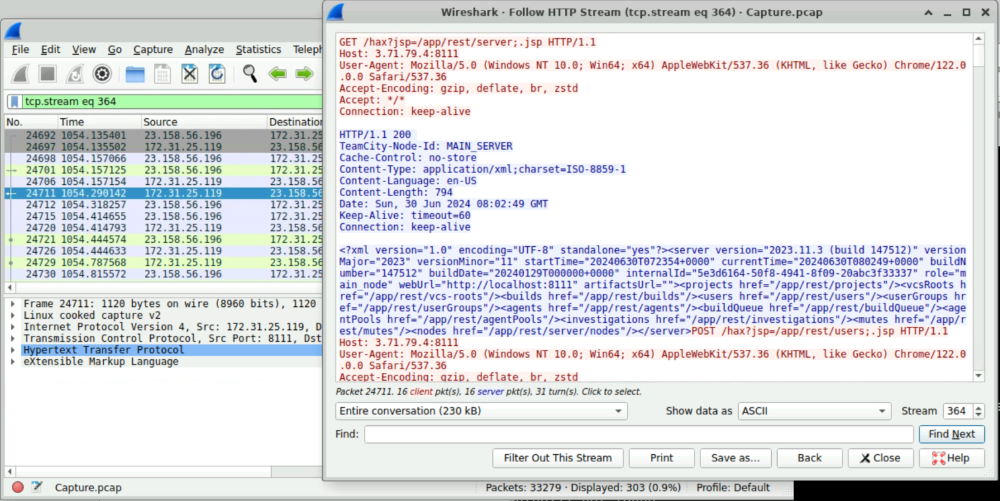
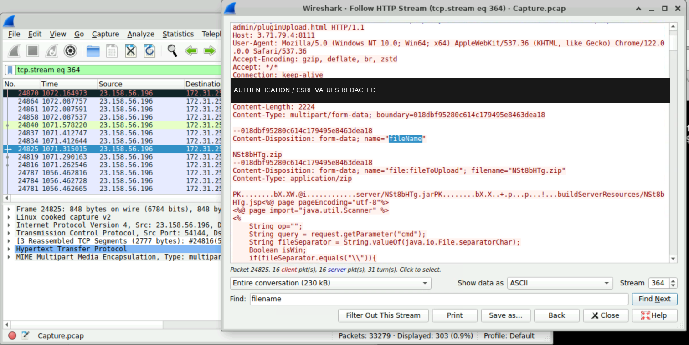
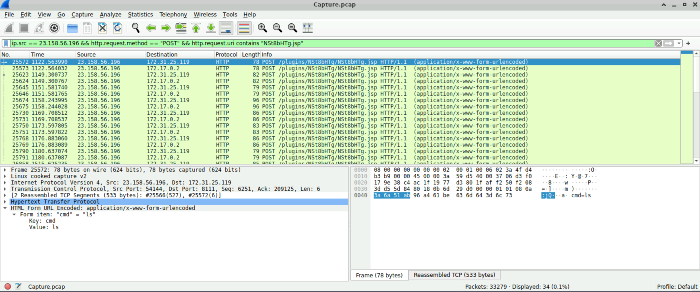
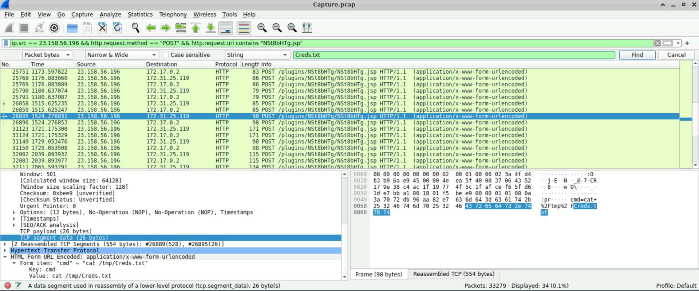
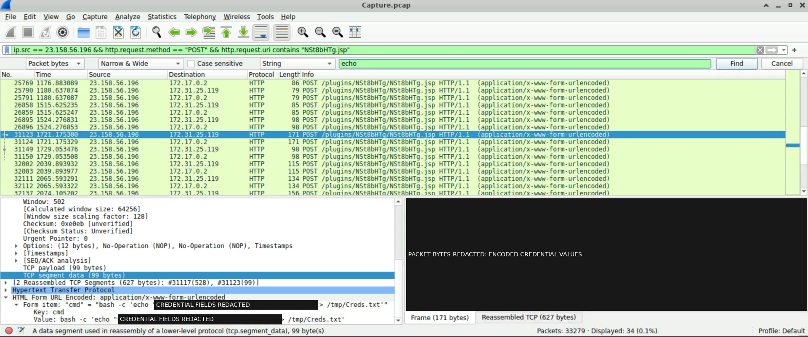
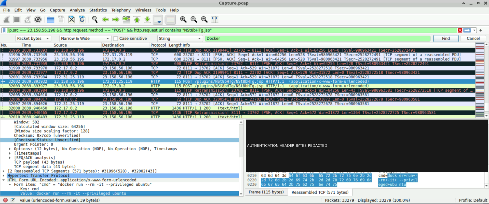
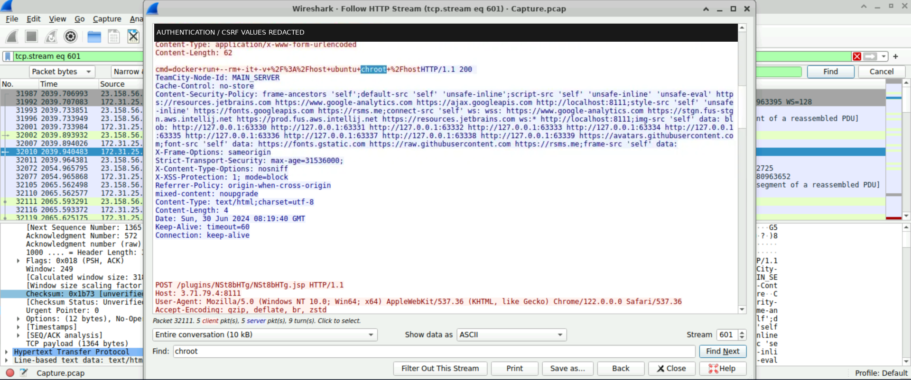

# JetBrains TeamCity — Technical Findings

Assessment date: **2026-11-07**. Status: **Preliminary, screenshot-supported network-forensics assessment**. Context: CyberDefenders JetBrains investigation.

This document develops seven findings from the preserved screenshot collection. It separates **direct observations** of displayed packet/stream material, **interpretations** of the submitted actions, and **unverified outcomes**. No finding establishes successful exploitation, webshell installation, operating-system command execution, credential collection, file modification, Docker startup, container escape or host compromise.

## Evidence basis and presentation

The following documents were read before drafting, and remain unchanged:

- [Screenshot manifest](../evidence/SCREENSHOT_MANIFEST.csv): original filenames, evidence IDs and SHA-256 preservation hashes for 70 screenshots.
- [Preservation notes](../evidence/PRESERVATION_NOTES.md): inventory and preservation scope; no formal chain-of-custody or authenticity claim.
- [Technical evidence register](../evidence/TECHNICAL_EVIDENCE_REGISTER.md): packet observations, associations and limitations.
- [Preliminary attack timeline](../evidence/ATTACK_TIMELINE.md): event ordering and targeted timestamp verification.
- [Latest MITRE ATT&CK mapping](../evidence/MITRE_ATTACK_MAPPING.md): **seven unique techniques**, including the restored, tentative **T1565.001 — Stored Data Manipulation**.

For this document, **EV-008, EV-014, EV-062, EV-065, EV-066, EV-068 and EV-070** were re-inspected using temporary copies whose SHA-256 hashes matched the original manifest. Direct observations below describe those screenshots, not an independent examination of the source capture. Other cited screenshots retain their inherited evidentiary role. `Capture.pcap` is the filename displayed by Wireshark; this review did not acquire or validate that capture.

One selected screenshot is embedded beside each finding. These are **presentation derivatives**, cropped to remove unrelated desktop material and, where necessary, irreversibly masked to remove credentials, Bearer tokens, CSRF values and their encoded packet-byte representations. They are not additional independent evidence. Original filenames are stated exactly in each finding; original files remain in their preserved location. [DERIVATIVE_MANIFEST.csv](figures/DERIVATIVE_MANIFEST.csv) records each source ID/filename/hash, derivative filename/hash, crop and redaction coordinates. Coordinates use the original image's top-left origin and exclusive right/bottom bounds. Derivatives are RGB PNGs without copied metadata or resizing; black labels are editorial redactions. Their hashes are distinct from the original preservation hashes.

Numeric **Wireshark Time** values are reproduced exactly. The relative-seconds interpretation remains provisional because display mode and reference point are unverified. Screenshot dates, filesystem modification times and server HTTP Date headers do not establish absolute event times. The established selected-event order remains **24711 → 24825 → 25572 → 26895 → 31123 → 32002 → 32111**; it is not a complete attack history.

## Response priority, potential impact and evidence confidence

Each finding separates four assessment fields:

- **Potential impact:** Conditional consequences if the requested capability succeeded, subject to effective permissions and affected assets. These consequences are not observed incident outcomes.
- **Recommended response priority:** Provisional urgency for defensive investigation, considering the observed action and requested access. High priority can describe a dangerous request whose outcome remains unverified.
- **Evidence confidence:** Confidence in the stated observation or interpretation, assessed independently of execution and impact.
- **Confirmed incident severity:** The evidence-supported incident-impact assessment. This is **Undetermined for all seven findings**; the screenshots do not confirm exploitation, command execution, compromise or operational impact. F-001 establishes advertised version disclosure, not a confirmed vulnerable configuration.

**Overall incident severity cannot be conclusively determined from the available network screenshots.** Asset criticality, effective permissions, authorization, successful outcomes and business impact remain unresolved. No CVSS score is assigned. The existing Medium/High values are retained as **provisional recommended response priorities**, with finding-specific reasons below; they are not confirmed incident-severity ratings.

| Recommended response priority | Decision rule for this assessment |
|---|---|
| Critical | Reserved for corroborated activity establishing severe, extensive impact or uncontrolled privileged compromise. The selected evidence does not meet this threshold. |
| High | A concrete attempt to introduce a server-side command interface or request container privileges/host-filesystem access with potentially broad consequences. Outcome verification is urgent. |
| Medium | Disclosed version information with suspicious request context, or a bounded discovery/read/write request with a meaningful security concern, but no established sensitive contents, operational effect or broader access. |
| Low | Limited security relevance or routine information without a material exposure or suspicious action established. No finding receives this response priority. |

**Confidence is assessed separately for the proposition being stated.** High means explicit, readable text or identifiers; Moderate means meaningful interpretation or indirect association requiring context; Low means a weakly supported hypothesis. Confidence in request text is not confidence in successful execution. Outcomes without corroboration are recorded as **unverified**, rather than given a speculative success probability.

| Finding | Potential impact if successful | Recommended response priority (provisional) | Evidence confidence | Confirmed incident severity | ATT&CK assessment |
|---|---|---|---|---|---|
| F-001 | Follow-on targeting; unauthorized CI access if genuinely vulnerable and exploited | Medium | High: advertised version/build; Low: exploitation hypothesis | Undetermined; vulnerability/exploitation unverified | T1190, tentative |
| F-002 | Reusable command access to service-accessible CI data and systems | High | High: upload content; Moderate: webshell placement interpretation | Undetermined; deployment/execution unverified | T1505.003, tentative |
| F-003 | Filename discovery supporting further activity | Medium | High: `ls` submission; Moderate: webshell-use interpretation | Undetermined; execution/listing unverified | T1083, observed attempt; T1505.003, tentative |
| F-004 | Sensitive-file disclosure if real secrets existed and were readable | Medium | High: file-read request; Moderate: possible collection purpose | Undetermined; file access/disclosure unverified | No technique assigned |
| F-005 | Stored-file integrity effects if another process relied on its contents | Medium | High: shell/write command; Moderate: stored-data manipulation interpretation | Undetermined; execution/modification unverified | T1059.004, observed attempt; T1565.001, tentative |
| F-006 | Weakened container isolation and expanded capabilities/device access | High | High: privileged-container command; Moderate: stream association | Undetermined; startup/privilege grant unverified | T1610, observed attempt |
| F-007 | Broad host-filesystem read/write access under effective permissions | High | High: stream body; Moderate: frame association and overall technique interpretations | Undetermined; mount/chroot/host access unverified | T1610, observed attempt; T1611, tentative |

ATT&CK references and confidence follow the latest mapping's stated verification basis. They describe behaviour and assessed intent, not achieved tactics. Recommendations below are proposed defensive actions; none were executed as part of this reporting task.

## F-001: TeamCity Server Identification and Potential Vulnerability Exposure

**Potential impact:** Advertised version information can support follow-on targeting. If the instance were genuinely vulnerable, reachable and successfully exploited, unauthorized access could affect CI functions and service-accessible assets. The banner does not establish those conditions.

**Recommended response priority — Medium, provisional.** Retained for version/mitigation validation and review of the unusual request path. Version disclosure alone would normally support a lower informational priority; the suspicious routing context justifies investigation. The screenshot establishes neither the effective patch/mitigation state nor a successful initial-access event.

**Evidence confidence — High** for the advertised version/build and displayed frame/stream references. **Low** for the tentative exploitation hypothesis, because the request's authorization context, source-packet linkage and exploit effects remain unverified.

**Confirmed incident severity — Undetermined.** Version disclosure is observed; vulnerable configuration, CVE-2024-27198 exploitation, compromise and operational impact are unverified.

**Relevant evidence IDs:** EV-008, primary; EV-014, later upload context only, documented under F-002.

**Exact packet references:** Frame **24711**, HTTP/TCP stream **364**, Wireshark Time **1054.290142**. The screenshot links the selected row, packet-details frame heading and stream footer to 24711. Frame **24825** is subsequent upload context, not an exploit-success response.

**Strongest screenshot / original filename:** **EV-008 — `Screenshot From 2026-11-03 01-41-04.png`**.



*Figure F-001 — EV-008, cropped presentation derivative. The XML response advertises TeamCity 2023.11.3, build 147512; the selected row and stream footer identify frame 24711 in stream 364. This supports server identification, not an exploitation outcome.*

### Direct observations

The stream displays an **HTTP 200** response with XML advertising **TeamCity 2023.11.3**, build **147512**, and HTTP Date **Sun, 30 Jun 2024 08:02:49 GMT**. A visible stream request above the response reads `GET /hax?jsp=/app/rest/server;.jsp HTTP/1.1`. This request-line visibility is a clarification from the current screenshot review; its separate request frame and exact request-response pairing have not been independently validated. The server Date is not an independently validated event timestamp.

### Technical analysis

**CVE-2024-27198**, a TeamCity authentication-bypass vulnerability, is a relevant hypothesis to assess against the advertised release and unusual request path. The vendor's [security update notice referencing the 2023.11.4 release](https://blog.jetbrains.com/teamcity/2024/03/additional-critical-security-issues-affecting-teamcity-on-premises-cve-2024-27198-and-cve-2024-27199-update-to-2023-11-4-now/) is a remediation reference. Retrieval failed with DNS resolution errors during this task; no fresh vendor-source verification is claimed. Verify the installed version, applicable security fixes and mitigations before concluding that this instance was exploitable.

Version disclosure alone does not establish an exploit attempt or successful exploitation. The unusual request syntax adds investigative context, but does not establish unauthenticated access, CVE-specific attribution or bypass success. Later plugin activity does not supply the missing authorization evidence.

### Security significance

A CI server can mediate source, build artifacts and deployment credentials. A vulnerable externally reachable instance could expose those functions, but the actual deployment, external exposure controls and affected assets are not established here. The disclosed version helps prioritize validation.

### MITRE ATT&CK mapping

[**T1190 — Exploit Public-Facing Application**](https://attack.mitre.org/techniques/T1190/), Initial Access: **tentative, Low confidence**, retained as a hypothesis consistent with the latest mapping. No successful exploitation or additional reconnaissance technique is assigned.

### Detection opportunities

- Review HTTP access/security logs for unusual TeamCity routing such as the visible `jsp=` path construction and access to server-information REST resources. Correlate the raw URI, authenticated principal, response type and subsequent administrative requests.
- Compare software inventory and vendor mitigation records with the advertised version. A banner alert alone should trigger validation, not a compromise conclusion.

### Recommended defensive actions

- Validate the installed release and security fixes; update to a currently supported, vendor-fixed release where needed. Restrict TeamCity administration to approved management access.
- Preserve relevant access, authentication and audit logs, then establish the triggering request's authorization state and any server-side effect.

### Limitations and alternative explanations

An authorized API query, security test or simulated lab interaction could produce disclosure. A response banner could also differ from the effective patched state. The visible GET is stream context without a separately verified request-frame mapping. The screenshot does not establish CVE exploitation or the endpoint's complete configuration.

## F-002: Suspicious Plugin Upload and Webshell-Capable JSP

**Potential impact:** If accepted and executable, the uploaded component could provide reusable server-side command access to data and systems reachable under the CI service's effective permissions. Those permissions and accessible assets are unknown.

**Recommended response priority — High, provisional.** Retained because submitting command-handling JSP content through plugin administration presents a plausible route to a reusable command interface with broad consequences. Urgent validation is warranted even though deployment remains unverified.

**Evidence confidence — High** for the archive name, JSP content and displayed frame/stream association. **Moderate** for interpreting the submission as attempted webshell placement; acceptance, installation, activation and persistence remain unverified.

**Confirmed incident severity — Undetermined.** Upload submission is observed; acceptance, storage, installation, activation, successful execution, persistence, compromise and operational impact are unverified.

**Relevant evidence IDs:** EV-014, primary; EV-062, subsequent matching-path command context under F-003.

**Exact packet references:** Frame **24825**, HTTP/TCP stream **364**, Wireshark Time **1071.315015**. The selected packet-details frame and stream footer both identify 24825. Frame **25572** supplies later request context only.

**Strongest screenshot / original filename:** **EV-014 — `Screenshot From 2026-11-03 02-10-16.png`**.



*Figure F-002 — EV-014, cropped and redacted presentation derivative. Stream 364 associates packet 24825 with the plugin-upload path, archive `NSt8bHTg.zip`, JSP content and `request.getParameter("cmd")`. The view supports upload submission, not installation or activation.*

### Direct observations

The register identifies a multipart **POST** to **`/admin/pluginUpload.html`**. The screenshot's stream begins with a clipped request line showing the upload path; the method is inherited from the register rather than legible in that foreground fragment. Multipart fields name **`NSt8bHTg.zip`**, with archive text including **`NSt8bHTg.jsp`** and **`request.getParameter("cmd")`**. Authentication and CSRF fields are present in the source but redacted in the derivative; their presence does not establish validity or authorization.

### Technical analysis

A JSP accepting a command parameter, delivered through a plugin upload and followed by requests to a matching JSP path, supports a **webshell-capable component** interpretation. The selected source fragment is not a full independent code review of the archive. Submission, acceptance, storage, installation, activation and working execution are separate stages; this screenshot establishes the submitted content, with no corroboration of those later stages.

### Security significance

If accepted and executable, such a component could expose a server-side command interface under the application's effective permissions. That could place build data and reachable services at risk. The service identity, privileges and actual accessible resources remain unknown.

### MITRE ATT&CK mapping

[**T1505.003 — Server Software Component: Web Shell**](https://attack.mitre.org/techniques/T1505/003/), Persistence: **tentative, Moderate confidence**. The mapping describes attempted placement; it does not establish installation or persistence.

### Detection opportunities

- Correlate administrative plugin uploads with approved changes, uploader identity and later requests to newly introduced JSP paths.
- Inspect uploaded archives for executable JSP resources and command-handling constructs. Alert on unexpected plugin/resource writes using file-integrity and TeamCity audit telemetry.

### Recommended defensive actions

- Preserve the uploaded archive, matching responses, plugin inventory and installation/audit logs if available; determine whether the component reached disk or became executable.
- Restrict plugin administration to approved operators and trusted components. If unauthorized deployment is verified, preserve it before disabling access and removing it through incident-response procedures.

### Limitations and alternative explanations

Authorized testing or a diagnostic plugin could explain submission. The archive could have been rejected, malformed, stored without activation or blocked from execution. The filename and later matching requests do not prove successful installation. No upload response or deployed artifact is established by the selected references.

## F-003: Webshell Command Submission and Directory Discovery

**Potential impact:** A successful directory listing could disclose filenames and help select paths for further activity. Its contents and any downstream access are unknown; the broader reusable-interface risk is assessed in F-002.

**Recommended response priority — Medium, provisional.** Retained for a concrete discovery request through the suspected command interface. The submitted `ls` command is bounded, and no returned directory contents or downstream access justify elevating this finding's priority.

**Evidence confidence — High** for frame 25572's command submission and discovery semantics. **Moderate** for the webshell-use interpretation based on the matching JSP name and parameter. Successful execution remains unverified.

**Confirmed incident severity — Undetermined.** Command submission is observed; execution, a returned listing, compromise and operational impact are unverified.

**Relevant evidence IDs:** EV-062, primary; EV-060 and EV-061, corroborating views recorded in the register; EV-014, component context under F-002.

**Exact packet references:** Frame **25572**, Wireshark Time **1122.563990**. Reassembly: **25566 (527 bytes) + 25572 (6 bytes) = 533 bytes**. The stream number is **not established** by these references.

**Strongest screenshot / original filename:** **EV-062 — `Screenshot From 2026-11-04 20-53-31.png`**. Additional supporting originals: **EV-060 — `Screenshot From 2026-11-04 20-50-14.png`**; **EV-061 — `Screenshot From 2026-11-04 20-51-08.png`**. These show the same event, not three commands.



*Figure F-003 — EV-062, cropped presentation derivative. Selected frame 25572 identifies the JSP POST; the expanded form value and packet bytes show `cmd=ls`, with reassembly references to frames 25566 and 25572. No returned directory listing is displayed.*

### Direct observations

Frame 25572 is a client **POST** from **`23.158.56.196`** to **`172.31.25.119`**, targeting **`/plugins/NSt8bHTg/NSt8bHTg.jsp`**. Its six-byte form body is **`cmd=ls`**; the expanded decoded value is **`ls`**.

### Technical analysis

The command requests a listing of the current directory if executed. The URI and parameter match the JSP content in F-002, supporting attempted use of that command interface. The HTTP request itself does not establish that the JSP exists, invokes a process or returns command output. `ls` alone also does not identify a Unix shell interpreter; no T1059.004 mapping is added here.

### Security significance

Successful directory discovery could help an operator identify application files, build material or paths for further actions. The current working directory and visible filesystem would depend on the application's runtime context, neither of which is established.

### MITRE ATT&CK mapping

- [**T1083 — File and Directory Discovery**](https://attack.mitre.org/techniques/T1083/), Discovery: **observed attempt, High confidence** in command-purpose fit.
- [**T1505.003 — Server Software Component: Web Shell**](https://attack.mitre.org/techniques/T1505/003/), Persistence: **tentative, Moderate confidence** in attempted webshell use. Both mappings describe aspects of frame 25572, not separate events.

### Detection opportunities

- Detect POSTs to unapproved JSP resources with decoded command parameters; use the exact path as a case-specific indicator and also identify similar behaviour under other filenames.
- Correlate application request logs with process telemetry for unexpected discovery commands launched by the TeamCity service. Request-body visibility depends on sensor/log configuration.

### Recommended defensive actions

- Recover the correctly paired response and process records, including any exit status, to determine whether execution occurred.
- Restrict the suspicious endpoint while validating its origin and deployment status; review the service's filesystem access and approved diagnostic functionality.

### Limitations and alternative explanations

An authorized probe or nonfunctional endpoint can receive the same command. No matching response, process evidence, working-directory information or returned listing is established. This is the first selected command finding, not necessarily the first command in the capture.

## F-004: Attempted Access to `/tmp/Creds.txt`

**Potential impact:** A successful read could disclose sensitive material if the file existed, contained real secrets and was readable by the executing service. Credential consequences would depend on those secrets' validity and scope; the filename does not establish them.

**Recommended response priority — Medium, provisional.** Retained for a targeted local-file read request. File existence, contents and disclosure are unverified, so a sensitive-looking filename does not justify elevating priority on the assumption of credential theft.

**Evidence confidence — High** for the submitted read command and exact path. **Moderate** for interpreting its purpose as attempted local-file collection. Credential collection is not established.

**Confirmed incident severity — Undetermined.** The read request is observed; execution, successful file access, content receipt, credential compromise and operational impact are unverified.

**Relevant evidence ID:** EV-065, primary.

**Exact packet references:** Frame **26895**, Wireshark Time **1524.276831**. Reassembly: **26889 (528 bytes) + 26895 (26 bytes) = 554 bytes**. Stream number **not established**.

**Strongest screenshot / original filename:** **EV-065 — `Screenshot From 2026-11-04 20-58-29.png`**.



*Figure F-004 — EV-065, cropped presentation derivative. Selected frame 26895, packet bytes and the expanded form value support submission of `cat /tmp/Creds.txt`; the reassembly references are 26889 and 26895. The analyst's search field is not file-content evidence.*

### Direct observations

The client POST targets **`/plugins/NSt8bHTg/NSt8bHTg.jsp`**. The complete 26-byte encoded body is **`cmd=cat+%2Ftmp%2FCreds.txt`**, decoded as **`cat /tmp/Creds.txt`**. No returned file contents are displayed.

### Technical analysis

If executed with access to the named path, `cat` would read the local file in the executing process's filesystem context. Submission shows an attempt to obtain its contents, not proof that the file existed or held credentials. The analyst's `Creds.txt` search input identifies what was searched for, not what was stored.

The selected read occurs **before** frame 31123's write request in F-005. It cannot verify that later write, its success or the earlier contents of the file.

### Security significance

An operational web command interface with read access could expose files available to the service. This request identifies a concrete path for preservation and access review, but does not establish any secret disclosure, receipt of data or use of credentials.

### MITRE ATT&CK mapping

**No technique assigned**, consistent with the latest mapping. Possible collection intent is a **Moderate-confidence interpretation**, not a formal Collection or Credential Access assignment. T1552.001 is not restored on the strength of the filename.

### Detection opportunities

- Inspect decoded command parameters for local-file reads, including sensitive-looking paths; correlate these with unexpected file-open/read telemetry from the application process tree.
- Use the exact path as a case indicator while accounting for ordinary diagnostic reads. Do not log returned secrets into general-purpose alert text.

### Recommended defensive actions

- Preserve the file and relevant metadata if it exists, along with matched responses and process/file-access records. Keep any recovered contents under restricted handling and redact report values.
- Review service-account read permissions and temporary-file practices. If actual secrets and exposure are established, assess affected identities and rotate/revoke them according to scope.

### Limitations and alternative explanations

The file may be missing, unreadable, contain test data or reside in a different filesystem namespace than assumed. A failed command or rejected request could produce no data. No stream ID, command output, execution status or credential contents are established.

## F-005: Attempted Credential-File Creation or Modification

**Potential impact:** Successful creation or overwrite could affect stored-file integrity and any process relying on the file's contents. The file's operational role is unknown, and writing credential-labelled text is not an account-password change.

**Recommended response priority — Medium, provisional.** Retained for explicit shell invocation and intended local-file writing. No established state change, operational dependency or business effect supports a higher priority for this finding.

**Evidence confidence — High** for the submitted shell command and intended write semantics. **Moderate** for the tentative stored-data manipulation interpretation. Successful file creation or modification remains unverified.

**Confirmed incident severity — Undetermined.** Shell/write submission is observed; execution, file creation/modification, account change, credential use and operational impact are unverified.

**Relevant evidence ID:** EV-066, primary. F-004 provides chronology context, not write verification.

**Exact packet references:** Frame **31123**, Wireshark Time **1721.175300**; TCP payload **99 bytes**. Reassembly: **31117 (528 bytes) + 31123 (99 bytes) = 627 bytes**. Stream number **not established**. Nearby **31124**, Time **1721.175329**, is another client POST, not a confirming response.

**Strongest screenshot / original filename:** **EV-066 — `Screenshot From 2026-11-04 20-59-56.png`**.



*Figure F-005 — EV-066, cropped and redacted presentation derivative. Selected frame 31123, decoded command structure and reassembly references support a `bash -c` submission redirecting supplied credential fields to `/tmp/Creds.txt`. Both decoded credential occurrences and the packet-byte pane are masked; no filesystem result is shown.*

### Direct observations

The POST to **`/plugins/NSt8bHTg/NSt8bHTg.jsp`** submits this command structure, with all credential values redacted:

```sh
bash -c 'echo "username:[REDACTED],password:[REDACTED]" > /tmp/Creds.txt'
```

The redacted transcription preserves the command's structure, not its original credential values or byte length. The 99-byte payload count belongs to the original displayed request.

### Technical analysis

Explicit **`bash -c`** requests a Unix shell interpreter. The **`>`** operator requests creation of the target file if absent or truncation/overwrite if present, subject to execution, filesystem state and permissions. This is an intended effect, not a filesystem observation.

The command supplies text bearing username/password labels; it does not itself invoke an account-management interface. Prior file existence, contents, operational purpose, write success and subsequent readback are unknown. The earlier read in F-004 cannot establish a later change.

### Security significance

If the file were consumed by another process, replacement content could affect that process's decisions or authentication data. That dependency is hypothetical here. The immediate concern is attempted writing of supplied data through a server-side command interface, with no proven credential replacement, disruption or achieved Impact tactic.

### MITRE ATT&CK mapping

- [**T1059.004 — Command and Scripting Interpreter: Unix Shell**](https://attack.mitre.org/techniques/T1059/004/), Execution: **observed attempt, High confidence**, based on explicit `bash -c`.
- [**T1565.001 — Data Manipulation: Stored Data Manipulation**](https://attack.mitre.org/techniques/T1565/001/), Impact: **tentative attempted manipulation, Moderate confidence** in the behavioural interpretation. Redirection indicates an intended creation/overwrite of stored data; neither successful manipulation nor an impact objective is proven. Both techniques concern the same frame 31123.

### Detection opportunities

- Correlate unexpected shell invocations from the TeamCity process tree with writes/truncations to `/tmp/Creds.txt` and other sensitive paths.
- Detect command parameters combining interpreter invocation and file redirection. Preserve restricted raw telemetry where required, but redact credential values from alerts and report exports.

### Recommended defensive actions

- Preserve filesystem and process evidence before cleanup; establish the target's prior/current contents, ownership, timestamps and any consuming application.
- Remove unauthorized application-to-shell functionality and reduce service write permissions. Assess credential remediation only after determining whether the text represents real, affected credentials.

### Limitations and alternative explanations

This could be a test-data write, fixture creation or an unsuccessful submission. Read-only mounts, permissions, missing interpreters or a nonfunctional JSP could prevent the intended effect. Frame 31124's unopened body cannot be assumed to repeat the command or confirm it. No filesystem change, account change or credential use is established.

## F-006: Privileged Docker Container Deployment Request

**Potential impact:** If deployment and the privilege request succeeded, expanded capabilities and device access could weaken container isolation. Host risk would depend on the Docker daemon/runtime configuration and effective permissions; privileged mode alone does not establish escape.

**Recommended response priority — High, provisional.** Retained because the command explicitly requests privileged container deployment through the suspected command interface. The requested weakening of isolation warrants urgent validation, while Docker availability, startup and granted privileges remain unverified.

**Evidence confidence — High** for frame 32002's command and deployment semantics. **Moderate** for stream 601 membership, derived from EV-070's filtered background list. Neither confidence assessment establishes successful startup.

**Confirmed incident severity — Undetermined.** Command submission is observed; Docker execution, container startup, privilege grant, escape, host compromise and operational impact are unverified.

**Relevant evidence IDs:** EV-068, primary; EV-069, repeated command view recorded in the register; EV-070, stream membership only for this finding.

**Exact packet references:** Frame **32002**, Wireshark Time **2039.893932**. Reassembly: **31996 (528 bytes) + 32002 (43 bytes) = 571 bytes**. Stream **601** association comes from EV-070. Frame **32003**, Time **2039.893977**, is a client POST. Nearby HTTP 200 rows **32008 (2039.940450)** and **32010 (2039.940483)** lack verified request pairing and inspected bodies.

**Strongest screenshot / original filename:** **EV-068 — `Screenshot From 2026-11-04 21-18-40.png`**. Supporting originals: **EV-069 — `Screenshot From 2026-11-04 21-19-31.png`**, repeated view; **EV-070 — `Screenshot From 2026-11-04 21-24-13.png`**, stream membership only, embedded under F-007.



*Figure F-006 — EV-068, cropped and redacted presentation derivative. Frame 32002's decoded form and 43-byte body show the privileged Ubuntu-container request; the reassembly references are 31996 and 32002. Authentication bytes are masked. This screenshot supplies command evidence; EV-070 separately supplies the stream 601 association.*

### Direct observations

The POST targets **`/plugins/NSt8bHTg/NSt8bHTg.jsp`**. Its body is **`cmd=docker+run+--rm+-it+--privileged+ubuntu`**, decoded as:

```sh
docker run --rm -it --privileged ubuntu
```

### Technical analysis

`docker run` requests creation/start of an Ubuntu container. **`--privileged`** requests expanded runtime permissions; **`--rm`** requests removal on exit, and **`-it`** requests interactive input and a terminal. Execution requires a working Docker client, reachable daemon, sufficient authorization and usable image/runtime conditions. Terminal allocation can fail in a noninteractive web-execution context.

This command contains **no host-root bind mount and no `chroot`**. It is distinct from F-007. The privileged flag alone does not establish escalation or escape; HTTP 200 response rows do not prove Docker success.

### Security significance

If granted on a typical Linux Docker host, privileged operation can broaden capabilities and device access and weaken confinement. The effective risk depends on the daemon and host configuration. Automatic removal can also reduce surviving container artifacts after exit, without establishing any anti-forensic intent here.

### MITRE ATT&CK mapping

[**T1610 — Deploy Container**](https://attack.mitre.org/techniques/T1610/), Execution: **observed attempt, High confidence** in command fit; stream association remains Moderate. **T1611 is not assigned to this privileged-only request** under the latest mapping.

### Detection opportunities

- Alert on unapproved Docker creation requests using privileged mode; correlate daemon events with client identity, application process ancestry and request logs.
- Preserve create/start/die/destroy events and effective runtime configuration, since `--rm` may remove a successfully exited container. Network command text alone should not generate a confirmed-startup outcome.

### Recommended defensive actions

- Determine whether TeamCity could access a Docker socket/API and whether deployment events or container IDs exist for this request.
- Restrict Docker control to approved workloads and identities; prohibit privileged workloads where unnecessary and separate CI control services from privileged build execution.

### Limitations and alternative explanations

An approved administrative test could use the same syntax. Missing Docker access, image failures, policy denials or terminal requirements could stop deployment. EV-069 repeats the event. Frame 32003's body is unverified, and nearby status codes cannot establish container startup, escape or host compromise.

## F-007: Docker Host-Root Mount and Chroot Request

**Potential impact:** A successful host-root bind mount and usable `chroot` could make host configurations, data and secrets reachable, with possible modification under effective write permissions. The targeted Docker daemon host and starting containment are unknown.

**Recommended response priority — High, provisional.** Retained because the command explicitly requests broad host-filesystem access through a root bind mount and `chroot`. This urgency rests on the requested scope, not an assumed privileged flag or HTTP 200 result. Successful access and extensive privileged impact are unverified, so Critical priority is not justified.

**Evidence confidence — High** for the command body and stream number. **Moderate** for the body-to-frame association and overall technique assessments, because the association uses the stream footer and the escape interpretation depends on runtime context. Successful host access remains unverified.

**Confirmed incident severity — Undetermined.** The command body is observed; Docker execution, container startup, mount/chroot success, host access/modification, escape, compromise and operational impact are unverified.

**Relevant evidence ID:** EV-070, primary. EV-068 supports only the earlier, distinct Docker request under F-006.

**Exact packet references:** **Packet/frame 32111**, HTTP stream / TCP stream **601**, Wireshark Time **2065.593291**. The Follow HTTP Stream footer identifies **Packet 32111**; the background selected frame is **32010**, which must not replace that reference. The complete command body's request line/headers and its response frame ID are not established by this viewport. No reassembly segment list is assigned here.

**Strongest screenshot / original filename:** **EV-070 — `Screenshot From 2026-11-04 21-24-13.png`**.



*Figure F-007 — EV-070, cropped and redacted presentation derivative. HTTP stream 601 displays the host-root bind-mount/chroot body and footer reference Packet 32111, while the background selection remains 32010. The following HTTP 200 headers advertise four response bytes; no readable command output is shown.*

### Direct observations

The stream displays this complete **62-byte** form body:

```text
cmd=docker+run+--rm+-it+-v+%2F%3A%2Fhost+ubuntu+chroot+%2Fhost
```

Decoded command:

```sh
docker run --rm -it -v /:/host ubuntu chroot /host
```

The immediately following server response shows **HTTP/1.1 200**, **`TeamCity-Node-Id: MAIN_SERVER`**, **`Content-Type: text/html;charset=utf-8`**, **`Content-Length: 4`** and HTTP Date **Sun, 30 Jun 2024 08:19:40 GMT**. No readable response-body output or response frame identifier is visible. A later POST line appears below those headers; it must not be substituted for the preceding body's clipped request line.

### Technical analysis

**`-v /:/host`** requests binding the **Docker daemon host's** root filesystem at `/host` inside the new container. With ordinary Docker bind-mount defaults, this syntax requests read/write access because it specifies no read-only option; effective permissions and security controls may still constrain access. **`chroot /host`** then requests a changed process root using that mounted tree.

The daemon host is not necessarily the TeamCity host or the machine running the Docker client. Its identity and the client's initial container/namespace context must be established before concluding that a boundary was crossed. `chroot` changes a process's filesystem root; by itself it is not proof of a complete namespace escape. This command contains **no `--privileged` flag** and must not inherit that flag from frame 32002.

### Security significance

If the mount and access succeeded, host configuration, application data and secrets could become reachable, with possible modification under effective write permissions. The breadth of the requested filesystem access explains the High provisional response priority. None of those accesses or modifications is observed in the selected evidence.

### MITRE ATT&CK mapping

- [**T1610 — Deploy Container**](https://attack.mitre.org/techniques/T1610/), Execution: **observed attempt, Moderate overall confidence**; syntax is explicit, but the frame association remains indirect.
- [**T1611 — Escape to Host**](https://attack.mitre.org/techniques/T1611/), Privilege Escalation: **tentative, Moderate confidence**, consistent with attempted host-filesystem access through a container. Initial containment and actual escape are unverified.

### Detection opportunities

- Monitor Docker creation requests and effective container configuration for a bind source of `/`, especially with a `chroot` entry command. Correlate with the originating identity and application process.
- Review runtime mount events and host file-access telemetry. Require daemon/container evidence to elevate a network-observed request into confirmed host access.

### Recommended defensive actions

- Recover the complete stream and explicitly pair requests/responses; establish packet 32111's body linkage before assigning a response or outcome.
- Preserve daemon events, container configuration, mount information and process context. Determine daemon location and the starting namespaces/privileges; restrict host-root mounts and unnecessary Docker API/socket access.

### Limitations and alternative explanations

The request could represent authorized maintenance, a test or a failed operation. Daemon policy, access controls, missing images, unavailable host binaries or terminal requirements could prevent success. A remote daemon would change which host root is targeted. Neither HTTP 200 nor an advertised four-byte response length proves execution, startup, mount success, `chroot` success, escape or host compromise.

## Outstanding evidence gaps and consistency review

| Gap | Evidence needed and assessment it would resolve |
|---|---|
| Source capture, timing and packet associations | Preserve/validate the source capture, capture topology and time-display configuration. Confirm full reassembly, request-response pairing and stream IDs for 25572, 26895 and 31123. Validate 32111's body association directly. Absolute timing remains unresolved. |
| Exposure and exploitation | Establish installed version/mitigations, external reachability, the triggering request's frame and authorization state, and exploit-specific server effects. This would distinguish disclosure, suspicious routing and actual CVE exploitation. |
| Upload and webshell deployment | Obtain the upload response, original archive, server-side plugin/JSP artifacts and installation/activation audit records. Matching later URIs alone do not establish deployment. |
| Command execution and discovery/read outcomes | Obtain matched response bodies, process records and exit status. No returned directory listing or `/tmp/Creds.txt` contents are established. If secrets are recovered, keep report values redacted. |
| Stored-file effect and purpose | Establish prior/current file state, write telemetry, subsequent readback and operational use. The earlier read cannot validate the later write; a write alone would not prove an impact objective or account change. |
| Container deployment and host access | Obtain Docker create/start records, container IDs, effective privilege/mount configuration, daemon identity, initial containment and host-specific access evidence. Assess each Docker command separately. |
| Scope and authorization | Identify approved testing/administration, service identities and affected assets. The screenshot context is a lab; it does not establish actor identity, malicious authorization state, business impact or the complete activity sequence. |

**No conflicting version, frame/Time pair, command, original filename or seven-technique count was found across the supplied documents and selected screenshot checks.** The restored T1565.001 remains tentative under Impact, with Moderate behavioural confidence. T1190, T1505.003 and T1611 retain their existing tentative status; no additional techniques are introduced.

One **visibility clarification** was identified: EV-008 shows a GET request line above the version response. The existing documents leave the exact triggering request unverified. The current review narrows that gap to independently establishing the request frame, pairing and authorization/effect; it does not resolve exploitation. The source documents were not edited and the T1190 assessment was not upgraded.

Other existing cautions remain material: **31124 and 32003 are client POSTs**; **32008/32010 are not verified command-success responses**; **EV-069 repeats EV-068**; and **EV-070's selected background frame 32010 does not identify the foreground command associated through the footer with 32111**. Lab answer fields and analyst search inputs are not substituted for packet or filesystem evidence.

Validation completed: all **70 original screenshot SHA-256 hashes and file sizes matched the preservation manifest**, and the five source documents' SHA-256 hashes matched their pre-draft values. All local document/image links resolved; evidence IDs and original filenames matched the source manifest. The seven derivative hashes matched their separate manifest, and pixels outside the declared masks/crops matched their sources. Visual review checked the redactions in both decoded text and encoded byte views. These checks validate file/reference integrity, not execution outcomes or original authenticity.

The two required corrections in [TECHNICAL_FINDINGS_QA.md](TECHNICAL_FINDINGS_QA.md) have been applied: all seven findings now separate potential impact, recommended response priority, evidence confidence and confirmed incident severity, and F-001's title qualifies vulnerability exposure as potential. The existing response priorities and seven-technique mapping are retained. This resolves the QA classification/wording blockers for final reporting within the stated screenshot-supported scope; overall incident severity and successful outcomes remain unverified.

This QA-correction revision changed only this technical findings document. The QA review, seven presentation figures, derivative manifest, evidence documents and original screenshots were not modified. Nothing was published or uploaded; no final README or executive summary was created.
